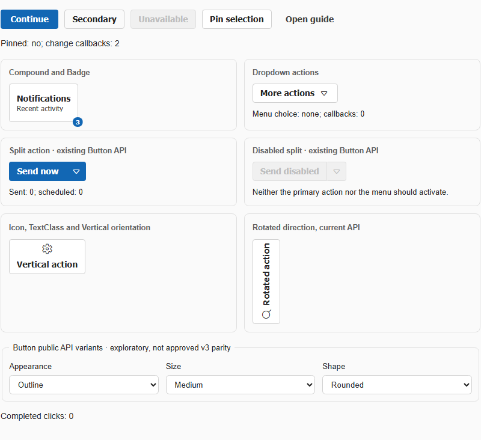
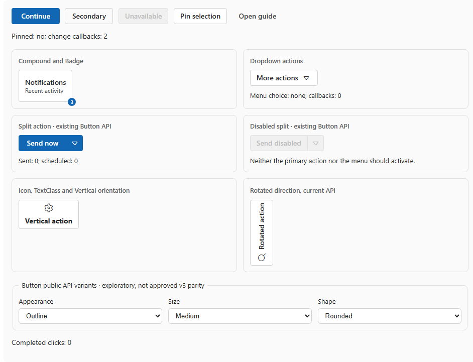

# #552 — Button #428: real Enter / Space toggle and pressed-semantics cross-mode evidence

**2026-10-19 · actual Chrome, real #421 Blazor Component Lab at `b9952aa93e89fd569de54080a7fdd06037b53a41`.** The same source specimens were exercised separately on WebAssembly Debug and **Release-published Production InteractiveServer**. This is behavioral/source evidence, **not full Fluent 2 parity, design acceptance or OS assistive-tech testing**.

| Action / state | WebAssembly | Published InteractiveServer |
| --- | --- | --- |
| Native Button focus | Focus succeeds | Focus succeeds |
| Starting bound `Toggled=false` | `Pinned: no; change callbacks: 0` | Same |
| Real Chrome **Enter** activation | `Pinned: yes; change callbacks: 1` | Same |
| Real Chrome **Space** activation | `Pinned: no; change callbacks: 2` | Same |
| Native disabled Button | `disabled=true` | Same |
| Link variant | Real native `a` with `href=getting-started` | Same |
| Toggle accessible role/name | `button`, **Pin selection** | Same |
| Toggle `aria-pressed` and AX pressed property | **Missing in all three states** | **Missing in all three states** |

Actual Chrome AX role/name comes from `Accessibility.getFullAXTree`; native Button states come from a real hydrated DOM. The toggle callback count proves **exactly one bound callback per observed keyboard activation**, with no extra invocation across the two actions. Importantly, the keyboard interaction itself **works**; do **not** report the Button as keyboard-inert.

| Current WASM native Button | Published Server native Button |
| --- | --- |
|  |  |

## The diagnostic harness false positive we rejected

Our initial Chrome DevTools Protocol key sequence sent `keyDown` and `keyUp` for **Enter**, which delivered DOM key events but did **not** synthesize the native Button click. A browser-native Enter activation requires the **character event** as well in this CDP path (`Input.dispatchKeyEvent(type='char',text='\\r')`). After adding it, the real Button clicked and Blazor's Toggle callback advanced exactly as expected in both modes; **Space** remained correctly activated by its native sequence. This is a **QA harness correction**, not a Bluent product bug. A guard now prevents forgetting the Enter character event.

## Remaining #428 issue-owner fix/gates

`Button.razor.cs` already exposes `bool? Toggled`, `ToggledChanged` and a native `ClickHandler` that toggles and invokes callbacks. However, `Button.razor` does not assign intrinsic `aria-pressed` to the native toggle when `Toggled.HasValue`; the caller can supply ARIA through `AdditionalAttributes`, but the public toggle behavior currently does not provide accessible state **by default**.

The minimal proposed behavioral contract under **#428**: native Button with `Toggled.HasValue` should expose `aria-pressed=false/true` reflecting its current bound state; `Toggled=null` ordinary Button should not incorrectly claim toggle semantics. Preserve explicit caller ARIA override policy only after component-conventions #420 confirms it, and verify split/Popover compositions and no disabled-state event regressions. Visual Focus/Light/Dark/RTL, icon-text alignment, native OS/AT and approved editable Penpot Button frames remain independent acceptance gates.

**Do not implement inside this #552 audit-only PR.** Source/API conventions #420 and tokens #418 are still open (as of this checkpoint); #419 library and #417 architecture are closed. The current green 10/10 observed browser checks **prove successful keyboard operation and missing pressed semantics**, not a passed parity verdict.

## Reproduce

- WASM: `node scripts/quality/probe_v3_bluent_lab_reference.mjs C:/Projects/Bluent-issue421 docs/v3/quality/evidence button-keyboard WebAssembly`.
- Server: `./scripts/quality/run_v3_fileselect_published_server.ps1 -Scenario button-keyboard`; the existing isolated Release Production runner now also accepts this scenario.
- Machine evidence: [WASM JSON](evidence/BLUENT-LAB-P0-BUTTON-KEYBOARD-CHROME.json), [Production Server JSON](evidence/BLUENT-LAB-P0-BUTTON-KEYBOARD-SERVER-CHROME.json), each 10/10 browser observation checks, exact status snapshots and computed Chrome AX semantics.
- `python -m unittest discover -s scripts/quality -p test_v3_p0_button_keyboard_evidence.py -v` — 7 source/snapshot/negative-acceptance tests.

## Button icon accessibility follow-up (2026-10-20)

Real original Buttons demo Chrome/Edge samples for Small/Medium/Large show icon/text flex-box center-Y difference of 0px, but icon-only Button AX names are **private-use glyphs** and text-labeled Button names are prefixed by the glyph. Browser-only aria-hidden and explicit Button aria-label restore meaningful names; see [#552 paired source and semantic-policy research](FLUENT-PARITY-BUTTON-ICON-AX.md). This is not product repair or native screen-reader certification.
