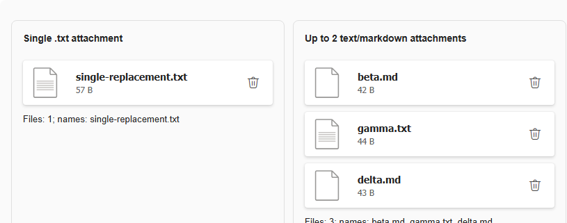

# #552 — Real Chromium FileSelect upload and accessible-name checkpoint

**2026-10-19. Actual browser evidence for current Bluent FileSelect #444, not Fluent component parity acceptance.**

Source: the hydrated **#421 Bluent WebAssembly Component Lab** (commit `b9952aa93e89fd569de54080a7fdd06037b53a41`) ran in a disposable Chrome profile. Actual synthetic `.txt`/`.md` files were written to a disposable directory, passed through Chrome **`DOM.setFileInputFiles`** and delivered to the real Blazor `<InputFile>` element and `OnChange` callback. All synthetic files and QA browser profiles were cleaned up after the run. No actual user file, production upload API, or server storage was touched.

The exact published `@fluentui/web-components@3.1.3` custom-element manifest does **not** include a `fluent-file-select` tag, so no fictional upstream one-to-one control is claimed. FileSelect remains a proposed Bluent native-file-picker + Button + Cards composition.

## 1. MaxFiles=2 is a display gate, **not cumulative collection enforcement**

| Actual action against current FileSelect | Real callback/DOM count | Picker visible |
| --- | --- | --- |
| Initial state | 0 | Yes |
| Choose `alpha.txt` and `beta.md` together | 2 | No |
| Remove `alpha.txt` using its real Button | 1 | Yes |
| Choose `gamma.txt` and `delta.md` in the next real file-selection event | **3, despite MaxFiles=2** | No |

**Actual resulting collection:** `beta.md`, `gamma.txt`, `delta.md`.

Reproduction is source-explained: `FileSelect.razor` checks `_files.Count < MaxFiles` **only while deciding whether to show the picker button**. In `FileSelect.razor.cs`, `HandleFileChanged` calls `args.GetMultipleFiles(args.FileCount)` then calls `_files.Add(file)` for every file without enforcing remaining capacity. Hiding the picker after reaching MaxFiles does not constrain how many files are accepted in a subsequent batch.

**Required #444 owner decision/acceptance:** implement a defined batch-acceptance policy (reject an over-capacity batch with user-visible feedback, or accept up to remaining slots; the choice needs maintainer/design approval) and enforce `MaxFiles` on both *one-event* and *cumulative* selections. Ensure event callbacks count only accepted files, selection/remove/clear events remain coherent, and the UI cannot silently exceed the limit. The demo must test empty state, exactly-at-max, remove/reselect, and too-many-in-one-batch cases across WASM and published Server.

## 2. Delete action's accessible name is an **icon-font glyph**, not meaningful text

The actual selected-file button in `#lab-file-multi .files button` was resolved through CDP DOM APIs and inspected via `Accessibility.getPartialAXTree`, scoped to its **backend node**. Chrome reported:

| AX property | Actual value |
| --- | --- |
| Role | `button` |
| Name | `` (one Unicode Private Use Area font-icon character) |
| Ignored | `false` |
| HTML `aria-label` / `title` | Both absent |

Thus the issue is **not** literally an empty accessible name. It is an unusable/icon-glyph-derived name that does not say "Remove file" or identify the affected filename. The source has an `Icon="@FluentIcons.Delete"` Button with no explicit accessible text/label.

**Required #444 owner decision/acceptance:** supply localized, contextual accessible text per file, e.g. *Remove beta.md* via the component's supported `aria-label` or equivalent; verify computed AX name and keyboard-focus/activation and later native screen-reader output. Do not rely on PUA icon glyphs or screen-reader pronunciation. Focus restoration after deleting a selected item, RTL and mobile card layout spacing remain separate gates.

## 3. Actual working cases and scope boundaries

- Single-file upload propagates name through the Lab's real callback and replacing `alpha.txt` with `single-replacement.txt` leaves exactly **one** selected file.
- `multiple` is false for `MaxFiles=1`, true for `MaxFiles=2`. `accept` matches `.txt` and `.txt,.md` respectively.
- The demo's disabled FileSelect action is actually rendered as a disabled Button.
- `Accept` is a **native chooser hint**, not file-extension or MIME/size authorization. This audit did not bypass it with a malicious file, did not test native Windows file-picker dialogs, server-side checks, actual OS/AT, large-file security or upload to production. Browser CDP `DOM.setFileInputFiles` bypasses opening the OS dialog but delivers a genuine file-input change to Blazor.
- The screenshot and semantics come from an isolated source Lab, not an approved design frame or a Fluent upstream file-picker counterpart.
- Original source remains untouched; #444 owns implementation after design approval. These are observed defects, not 16 passing Fluent parity tests.

## Reproduction and guarded snapshots

- Runnable local real-Chrome audit: `node scripts/quality/probe_v3_bluent_lab_reference.mjs C:/Projects/Bluent-issue421 docs/v3/quality/evidence file-upload`.
- Structured real-browser output: [`BLUENT-LAB-P0-FILE-UPLOAD-CHROME.json`](evidence/BLUENT-LAB-P0-FILE-UPLOAD-CHROME.json), includes six stage snapshots, full real callback names, scoped Chrome AX role/name, 16 successful *observation* checks, and synthetic-only file names.
- Stored evidence/negative-acceptance guards: `python -m unittest discover -s scripts/quality -p test_v3_p0_fileselect_live_upload.py -v` (**9 tests**).
- No actual upstream or Bluent product changes, no new design approval, no native screen-reader certification. Keep #552 **In progress** and #553 **Draft**, and treat #444 as the issue owner of both gaps.
