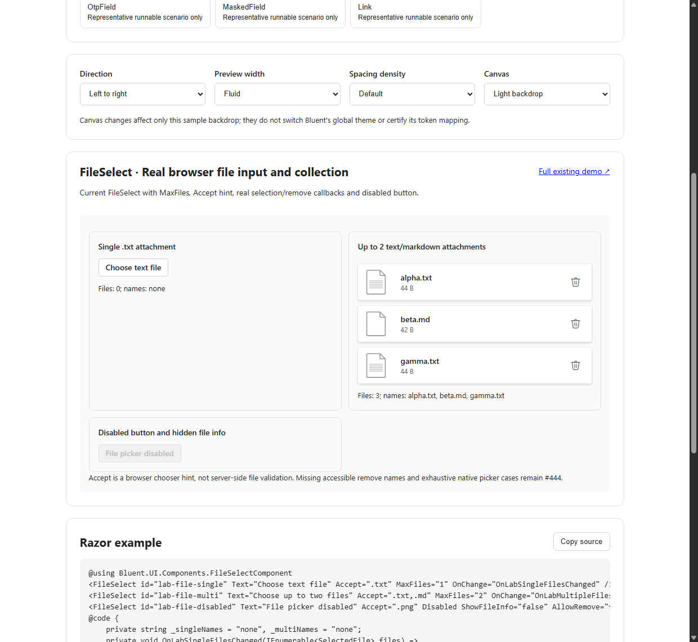
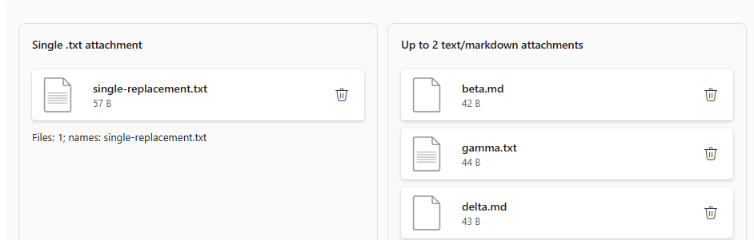

# #552 — FileSelect #444: actual published InteractiveServer parity-gap reproduction

**Executed 2026-10-19 on Dev01.** Real current #421 Component Lab code at `b9952aa93e89fd569de54080a7fdd06037b53a41`, published as a **Release build** of `Bluent.UI.Demo.SSR` in a disposable directory, hosted with `ASPNETCORE_ENVIRONMENT=Production`, route `/compatibility/component-lab-server` and the *same* shared `<ComponentLab />` used by WebAssembly. This is **published InteractiveServer, not WebAssembly, not static SSR and not a mocked FileSelect**.

A fresh isolated native Chrome CDP session used `DOM.setFileInputFiles` with real disposable, synthetic text/markdown files. The event traversed the published Server Blazor circuit and the real `<InputFile>` / `OnChange` callbacks. The independently executed earlier WebAssembly branch was also rerun with the new single-batch scenario. Neither original #421 source nor Bluent production code was modified.

## What was actually reproduced

| Real browser action | WebAssembly Debug Lab | **Published Production InteractiveServer** | Finding |
| --- | --- | --- | --- |
| Choose 2 files for `MaxFiles=2` | Count 2; chooser hidden | Count 2; chooser hidden | Button visibility gate works |
| Delete first of 2 files | Count 1; chooser returns | Count 1; chooser returns | Remove + callback works |
| In next picker batch, select another 2 files | **Count 3** | **Count 3** | **Cumulative MaxFiles violation** |
| Reload clean component; select 3 files in **one** picker event | **Count 3** | **Count 3** | **Single-batch MaxFiles violation** |
| Select and reselect one file with `MaxFiles=1` | Replaces original, remains 1 | Replaces original, remains 1 | Existing single-file behavior works |
| Chrome computed remove-button AX name | Private-use font glyph `` | Private-use font glyph `` | Neither supplies contextual accessible text |
| Disabled picker button | Disabled | Disabled | Expected native disabled behavior |

For **both** new one-batch runs, Chrome received `alpha.txt`, `beta.md`, `gamma.txt` and Blazor's visible callback reported `Files: 3` despite `MaxFiles=2`. For cumulative runs, the final list was `beta.md`, `gamma.txt`, `delta.md`. Tests verify actual card counts and callback text, not merely DOM construction or a guessed source path.

| Published Server: 3 files in one batch | Published Server: cumulative overflow after delete and reselect |
| --- | --- |
|  |  |

Comparable WASM evidence: [single-batch screenshot](evidence/BLUENT-LAB-FILESELECT-ONE-BATCH-CHROME.png), [previous cumulative screenshot](evidence/BLUENT-LAB-FILESELECT-FILE-UPLOAD-CHROME.png). The layout and samples are Component Lab test specimens, **not approved Fluent 2 designs**.

## Source diagnosis and remaining decisions for #444

`FileSelect.razor` gates whether to render the picker button on `_files.Count < MaxFiles`, while `FileSelect.razor.cs` calls `GetMultipleFiles(args.FileCount)` and appends every file from a batch, independently of the configured limit. The rendered delete Button has only `Icon="@FluentIcons.Delete"`, so Chrome computes its accessible name from the Private Use Area icon font character, rather than the filename or an accessible `aria-label`.

The owner #444 needs approved design/API decisions, then product implementation:

1. Decide what to do when a batch exceeds remaining slots: **reject the entire selection** with visible feedback, or **accept only remaining slots** with visible feedback. Both are plausible; neither should be silently invented during an audit. Enforce the rule for a single batch **and** accumulated selections, and keep callbacks/count consistent.
2. Give each remove control a meaningful localized, filename-specific accessible name, preserve focus on remove/reselect, verify via real Chrome AX and native screen readers.
3. Do not use `Accept` as security validation. Independently test server-side MIME/type/content/size/authorization and max stream sizes, real OS file-dialog behavior and actual Windows High Contrast/AT, mobile RTL and approved Fluent-composition design.

## Reproduction and provenance

- Executable Release Server publisher with isolated output and cleanup: `scripts/quality/run_v3_fileselect_published_server.ps1` on task branch #552. It invokes `dotnet publish ... -c Release --no-restore`, then the task's CDP probe in `Server` mode. The probe uses `ASPNETCORE_ENVIRONMENT=Production` and a disposable localhost port; it captures evidence, terminates its owned host/Chrome processes, and removes synthetic file directories and GUID browser profiles. The wrapper removes the disposable publish directory.
- Existing WebAssembly probe extended (without modifying #421) via `node scripts/quality/probe_v3_bluent_lab_reference.mjs C:/Projects/Bluent-issue421 docs/v3/quality/evidence file-upload`.
- Machine-readable actual Server evidence: [`BLUENT-LAB-P0-FILE-UPLOAD-SERVER-CHROME.json`](evidence/BLUENT-LAB-P0-FILE-UPLOAD-SERVER-CHROME.json); WASM: [`BLUENT-LAB-P0-FILE-UPLOAD-CHROME.json`](evidence/BLUENT-LAB-P0-FILE-UPLOAD-CHROME.json). Source metadata differentiates real published **InteractiveServer** versus **WebAssembly**.
- Real browser checkpoints: Server **12/12 observational checks pass**, WASM **17/17 observational checks pass**. These passing checks include explicit **known-gap** observations and do **not** mean the product is correct.
- Pinned source/evidence negative controls: `test_v3_p0_fileselect_live_upload.py` (**10 tests**) and `test_v3_p0_fileselect_published_server.py` (**7 tests**).
- The publish step also emitted NU1903 high-severity advisory warnings for the existing demo dependency `Microsoft.AspNetCore.Components.WebAssembly.Server 10.0.7`: GHSA-g27p-qf6j-c96c and GHSA-qjpx-jqm5-h2c4. These are dependency-update/security follow-ups **outside** #552's Fluent component audit, not a FileSelect UI result or proof of exploitability.
- **Not done:** native Windows file chooser, actual OS screen reader, real external upload endpoint/security, per-component design approval or product remediation. Keep #552 **In progress**, Draft PR #553, and product ownership with #444. No merge into stable `Dev`.
