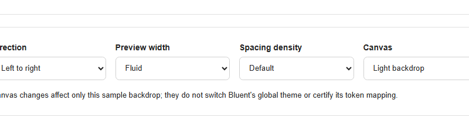
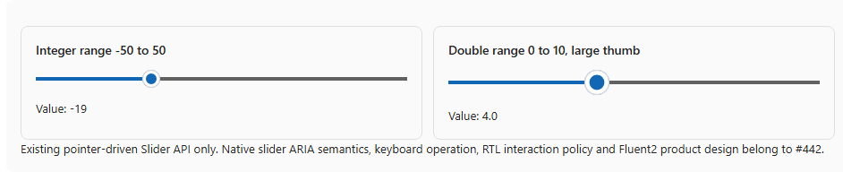
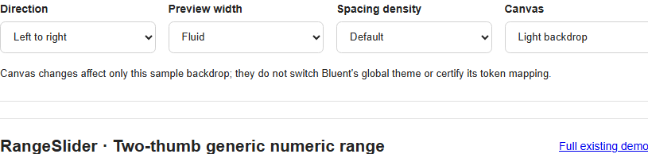
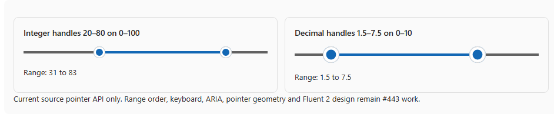

# #552 — real Chrome pointer + viewport scroll coordinate audit (Slider #442, RangeSlider #443)

**Executed 2026-10-19 on Dev01.** Real current #421 Lab at `b9952aa93e89fd569de54080a7fdd06037b53a41`, two **different live hosts**: WebAssembly Debug and genuinely **Release-published Production InteractiveServer**. Each used a disposable Chrome CDP browser/port, real `Input.dispatchMouseEvent` mouse movement / down / move / up and real Blazor `ValueChanged` status text. No synthetic Blazor pointer events, DOM value assignments or product-code changes. There is **no upstream 1:1 Fluent RangeSlider** in pinned WC v3.1.3; this is an audit of current native behavior and standard coordinate semantics, **not** accepted parity.

## Reproduced root cause: ScreenX and viewport BoundingClientRect are different coordinate systems

**The current source for BOTH controls does:**

`await CalculateValueFromPoint(args.ScreenX, args.ScreenY)` → `Dom.GetBoundingClientRectAsync(RailSelector)` → `var relativeX = screenX - (railRect.Left + ThumbSize/2)`.

`PointerEventArgs.ScreenX` and `screenY` are **screen/monitor-relative** CSS pixels. In contrast, `Element.getBoundingClientRect().left` is **viewport-relative**. Thus source subtraction has a variable offset from browser chrome/window placement. In the actual fresh headless Chrome runs on Dev01:

- `screenX - clientX = +18px`, **every one of eight real pointerdowns**.
- `screenY - clientY = +153px`, all eight samples. Y currently isn't used for horizontal sliders, but future orientation must avoid the same mixup.
- All eight real component PointerDowns were received and **ValueChanged rendered changed values in both hosts**. Therefore, **do not claim that pointer delivery is universally broken in InteractiveServer**. A previously reported Server-only pointer failure in some other context remains separately reproducible/not verified; this new smoke was successful.
- **Actual displayed values match the current erroneous ScreenX formula within 1 numeric point**, while the correct viewport/ClientX formula differs by **4.3 to 5.5 value points**. It is not only a source inference or a screenshot comparison.

## Eight actual browser numeric samples

Component bounds are **natural, not an imposed 260px QA width**. Each group executes a click/drag and then another click/drag after moving the app's *real* scroll position. All values below are exactly from the real Blazor source status after PointerDown. "Expected viewport" uses `clientX` against the real rail's bounding rect; "ScreenX model" is the existing source logic.

| Host | Family | State | Rail width | Actual status value | ScreenX model (rounded) | Correct viewport model (rounded) |
| --- | --- | --- | ---: | ---: | ---: | ---: |
| WASM | Slider #442 | Normal | 344px | 32 | 32 | 27 |
| WASM | Slider #442 | Scrolled | 344px | -21 | -21 | -27 |
| WASM | RangeSlider #443 | Normal (max handle) | 351.5px | 82 | 82 | 77 |
| WASM | RangeSlider #443 | Scrolled (min handle) | 351.5px | 29 | 29 | 23 |
| Published Server | Slider #442 | Normal | 415px | 31 | 31 | 26 |
| Published Server | Slider #442 | Scrolled | 415px | -22 | -22 | -26 |
| Published Server | RangeSlider #443 | Normal (max handle) | 415px | 81 | 81 | 76 |
| Published Server | RangeSlider #443 | Scrolled (min handle) | 415px | 28 | 28 | 24 |

Lab values: Slider Min=-50/Max=50, RangeSlider Min=0/Max=100, both `ThumbSize=20`. The proportion is clamped in [0,1] and the integer component result is rounded; arithmetic is guarded directly from the real captured X/Y/rects/status strings by `test_v3_p0_pointer_scroll_evidence.py`.

**Actual scroll model matters:** WASM MainLayout scrolls **inside `.page-content`** (scrollTop advances ~130px, `window.scrollY=0`); the published Server compatibility layout scrolls the **window** (`window.scrollY` advances ~130px and there is no `.page-content`). The audit script first falsely assumed both used window scroll, then corrected it to the real hosting layout. This is **test harness correction, not a Bluent product issue**.

## Visual specimens (real Chromium)

| WASM, after real pointer move | Production InteractiveServer, after real pointer move |
| --- | --- |
|  |  |
|  |  |

The first trial force-set a 260px width for a previous **visual** comparison fixture; after a Blazor render, it was reset to the natural 344/415px layout, producing an artificial apparent non-monotonic value change in that trial. **The fixed natural-width tests were rerun in BOTH modes; the table above comes only from the corrected runs.** Do not treat the initial width artifact as a component defect.

## Recommended owner #442 / #443 remediation design and acceptance (not yet implemented)

- Make pointer values and bounding rectangles use **the same viewport coordinate system**, e.g. `args.ClientX` and `railRect.Left` for horizontal, with safe zero-width/clamping handling. No blind `ScreenX` ↔ `ClientX` replacement without evaluating `DomHelper` event contracts, touch/pointer capture, RTL, disabled and vertical orientation.
- Under #443, define stable two-thumb selection, crossing/locking, min/max `aria-valuenow`/dependent bounds, keyboard, focus and accessible names using standard multi-thumb guidance. For #442, independently cover `Step`/orientation/accessible native slider roles and focus, plus `forced-colors` track fix. Those are **separate known gaps** not fixed by coordinate alignment.
- Re-run true mouse **and pen/touch** at multiple window placements, display scaling, nested scroll roots, RTL, both WASM and published InteractiveServer; verify exact `ValueChanged` transitions and pointer-up deregistration. Screenshot parity & approved Fluent design remain distinct gates.
- Even though this sample's Server callbacks worked, do not close the earlier claimed Server pointer issue without its original reproduction environment and broader coverage.

## Reproduction, data and limits

- `node scripts/quality/probe_v3_bluent_lab_reference.mjs C:/Projects/Bluent-issue421 docs/v3/quality/evidence pointer-scroll WebAssembly` launches an isolated current-source Lab + browser. For Server: `./scripts/quality/run_v3_fileselect_published_server.ps1 -Scenario pointer-scroll` independently publishes and deletes an isolated Production SSR host; the wrapper name pre-dates its optional pointer scenario.
- [Actual WebAssembly DOM/pointer events/geometry/values JSON](evidence/BLUENT-LAB-P0-POINTER-SCROLL-CHROME.json), [published Server version](evidence/BLUENT-LAB-P0-POINTER-SCROLL-SERVER-CHROME.json), each with two families × two pointer positions, exact pointer `screen/client` coordinates, scroll root, values and actual screenshots. Each run has **11/11 source/evidence observation checks pass**, not an assertion of correct values.
- `python -m unittest discover -s scripts/quality -p test_v3_p0_pointer_scroll_evidence.py -v` gives **8 evidence/negative-acceptance tests**; they prove current coordinate mismatch and must be rewritten when the owning product fix and new evidence are available.
- **Not tested:** actual multi-monitor window moves, native pen/touch/mobile, OS assistive technologies, OS High Contrast, accepted component design, keyboard parity, all value types, JavaScript event teardown under every host failure. No changes to the current public 2.x `Dev` branch.
