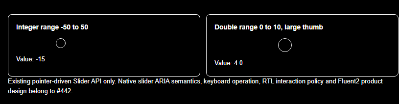
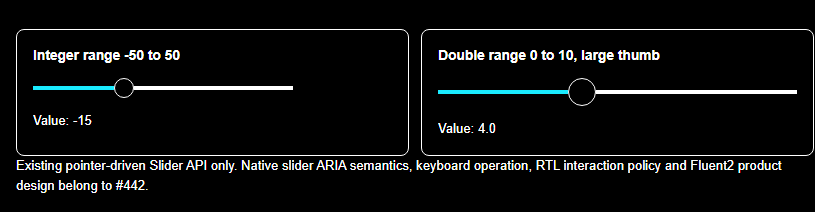
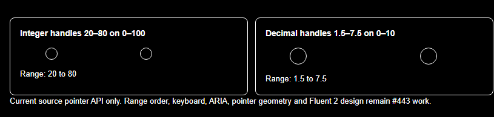
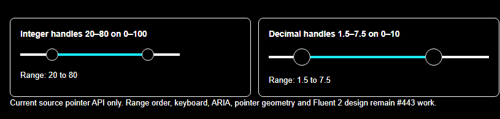

# #552 — Chrome accessibility-tree and keyboard crosswalk, plus Forced Colors rail prototype

**2026-10-19 · Real Chromium CDP evidence, not native OS assistive technology.** The controls were actually rendered in separate disposable Chrome profiles from (a) published `@fluentui/web-components@3.1.3`, and (b) real #421 WebAssembly Component Lab at source `b9952aa93e89fd569de54080a7fdd06037b53a41`. This work remains on the independent #552 audit branch. **No production Bluent source and no #421 demo source changed.**

## Semantic and keyboard observations

The browser's native `Accessibility.getFullAXTree` API, not a regex or a hand-authored ARIA approximation, was queried after the real controls had rendered and hydrated:

| Actual browser evidence | Fluent WC 3.1.3 | Bluent Component Lab |
| --- | --- | --- |
| Single-value Slider AX role | `slider`, accessible name **Volume**, value **40** | No `slider` node while #442 family is selected |
| Stepped Slider AX role | `slider`, accessible name **Brightness**, value **50** after an actual `ArrowRight` from initial 40 | No `slider` node for current #442 |
| Two-thumb range AX roles | No identical official WC custom element exported in pinned release; not a 1:1 comparison | **No `slider` nodes for either thumb** while #443 family is selected |
| Button keyboard | Real Tab from focused primary button advanced to another focusable control | Real Tab from focused Bluent Button advanced to another focusable control |
| Slider arrow keyboard | Real `ArrowRight` on focused stepped Slider changed value 40 → 50 | In #442 and #443 current Lab, `ArrowRight` produced no observed value-label change (and thumb/root lack focus target) |

Stored exact output: [official WC AX tree/keyboard evidence](evidence/FLUENT-WC-3.1.3-AX-KEYBOARD-CHROME.json), [Bluent family AX tree/keyboard observations](evidence/BLUENT-LAB-P0-AX-KEYBOARD-CHROME.json).

The browser accessibility tree is **stronger evidence than simple attribute inspection**, but **does not substitute** for real NVDA, JAWS, VoiceOver, Windows High Contrast, native mobile talkback, touch AT, or design approval. The full-page tree includes navigation and inspector UI; the test switches #421 to exactly one owning component family at a time. FileSelect remove-button accessible-name coverage remains **not evaluated when no file entry is rendered**.

## Experimental source-only Forced Colors fix

The source-backed [browser Forced Colors defect](FLUENT-WC-3.1.3-FORCED-COLORS-REFLOW.md) was reproduced again: Bluent `Slider` and `RangeSlider` rail DOM nodes are nonzero-size, but `background-image: none` and transparent `background-color` make the actual painted tracks invisible.

A **research-only stylesheet** — [`v3-p0-forced-colors-rail-proposal.css`](../../../scripts/quality/fixtures/v3-p0-forced-colors-rail-proposal.css) — was then injected **only at runtime into the isolated Chrome demo**, never into the compiled Bluent CSS. It uses system colors `CanvasText` for a solid fallback track and `Highlight` for a progress `::after` pseudo-element. The existing component's `--progress` / `--min-progress` / `--max-progress` CSS values drive the same semantic fill percentage without changing any C#/Blazor behavior.

| Current Bluent rail, no fallback | With **audit-only** solid-track candidate |
| --- | --- |
|  |  |
|  |  |

Computed paint confirmed in Chrome on **both** controls:

| Rail property | Existing Bluent Forced Colors | Browser-only proposal |
| --- | --- | --- |
| `background-image` | `none` | `none` |
| Base `background-color` | `rgba(0,0,0,0)` | `rgb(255,255,255)` (system `CanvasText` in this emulator) |
| Progress segment `::after` | transparent | `rgb(26,235,255)` (system `Highlight` in this emulator) |
| Example progress pseudo-element width | No painted segment | Slider ~91px; RangeSlider ~156px |

**This is a candidate, not an approved production fix.** It must undergo editable design approval (light/dark/RTL geometry, Thumb/fill contrast, disabled/focus state), independent real Windows HC verification, correct orientation/direction handling (the proposed `inset-inline-start` may need Bluent RTL policy alignment), SSR/WASM and real OS/screen-reader AT. The missing semantic Slider roles, keyboard behavior, multi-thumb dependent bounds and pointer/coordinate errors are **independent problems not solved by this CSS**. Product changes belong in #442 and #443 only after those gates.

## Reproduce and limits

The extended probes `scripts/quality/probe_v3_fluent_wc_reference.mjs` and `scripts/quality/probe_v3_bluent_lab_reference.mjs` accept a new fourth `ax-keyboard` scenario, preserving prior versions for baseline, light/dark RTL, Forced Colors and narrow reflow. The pinned WC fixture must be built from npm in an isolated scratch directory as described by [the release crosswalk](FLUENT-WC-3.1.3-P0-CROSSWALK.md). Each run captures real Chrome accessibility roles/names/values, actual Tab/ArrowRight events and a PNG. Bluent additionally measures before/after computed CSS and captures candidate after the browser-only stylesheet is injected.

Eight evidence/negative-scope tests: `python -m unittest discover -s scripts/quality -p test_v3_p0_ax_keyboard_proposal.py -v`. Passing these means pinned recorded observations are present and the candidate can paint **in this emulator**, not that accessibility or Fluent parity are accepted. The #421 retrospective matrix is still not-reviewed until component-specific design, API, behavior, visual and OS/AT gates pass. Keep #552 **In progress**, #553 **Draft**, stable `Dev` untouched.
