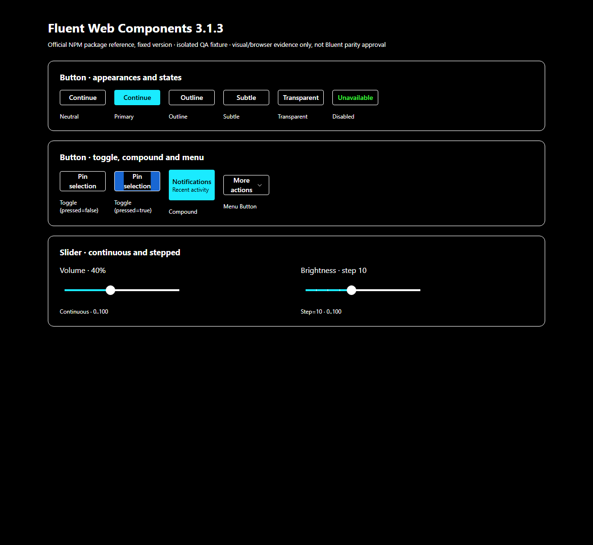
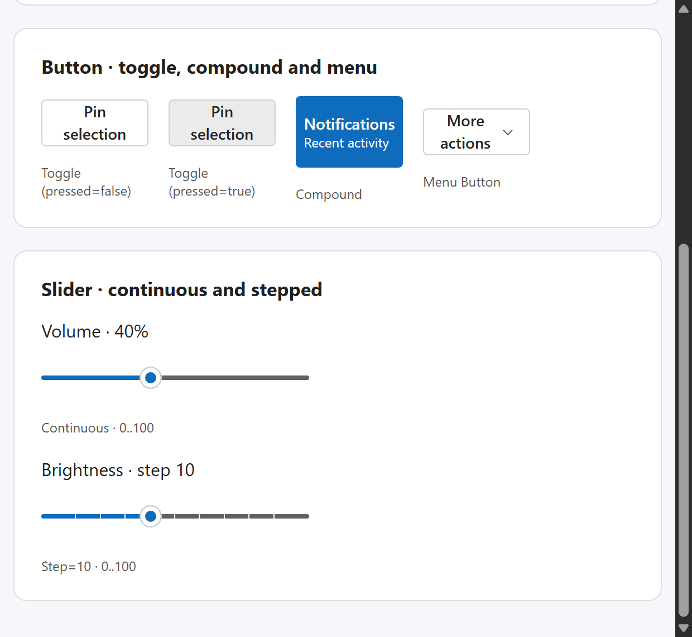
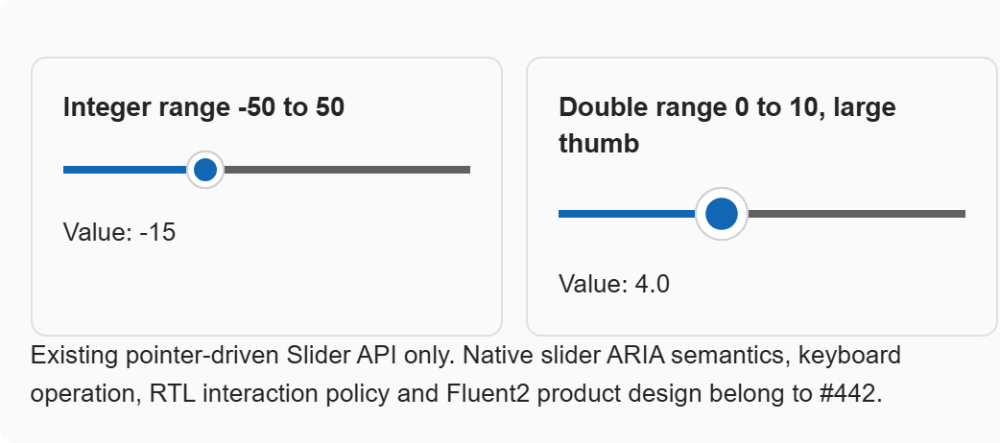

# #552 — real Chrome Forced Colors and 200%-equivalent reflow checkpoint

**2026-10-19 · Baseline: published `@fluentui/web-components@3.1.3` vs actual Bluent #421 WASM Lab.** Existing review remains **not approved**. This document distinguishes **CSS/media emulation** from genuine Windows High Contrast, native browser zoom, screen readers and OS/AT.

## 1. Forced Colors — reproduced material accessibility gap

Chromium DevTools Protocol `Emulation.setEmulatedMedia` was applied with `forced-colors: active` and `prefers-contrast: more` to **each independent real browser process**. Both source applications confirmed `matchMedia('(forced-colors: active)').matches === true` and `matchMedia('(prefers-contrast: more)').matches === true`, CSS viewport 1240px and devicePixelRatio 1.

| Actual released Fluent WC 3.1.3 | Actual current Bluent |
| --- | --- |
|  |  |

In the released Fluent fixture, both slider rail segments remain visible in the browser screenshot. In the current Bluent #442 Slider and #443 RangeSlider, **the visual rails disappear** under the same emulator while Thumb outlines remain.

This is not just a subjective screenshot assessment: both actual Bluent `.rail` elements still have a measured **nonzero width** and **4px height**, but computed CSS reports **`background-image: none` and `background-color: rgba(0, 0, 0, 0)`** in Forced Colors. The source in `src/Bluent.UI/Styles/Components/_slider.scss` and `_range-slider.scss` draws those rails exclusively with `background-image: linear-gradient(...)`. Chromium suppresses that gradient in forced-colors rendering; no non-image fallback is present. This is a **confirmed browser-level accessibility gap**, not yet a remediated issue.

Further evidence: [actual Bluent RangeSlider screenshot](evidence/BLUENT-LAB-RANGESLIDER-FORCED-COLORS-CHROME.png), [current Button screenshot](evidence/BLUENT-LAB-BUTTON-FORCED-COLORS-CHROME.png), [actual FileSelect screenshot](evidence/BLUENT-LAB-FILESELECT-FORCED-COLORS-CHROME.png) and the official [keyboard-focus screenshot](evidence/FLUENT-WC-3.1.3-FORCED-COLORS-CHROME-KEYBOARD-FOCUS.png).

In this emulated palette, the computed **official** primary button background is `rgb(26,235,255)`, while the **Bluent** primary is `rgb(0,0,0)`. Both buttons have readable visible text in their own layouts; this palette difference is a **design/token mapping question**, not automatic proof of a bug or permission to copy an upstream token verbatim.

**Proposed #442/#443 acceptance path** (not implemented here): approved editable Fluent-informed variant showing both progress and remaining segments in Forced Colors using system color tokens like `CanvasText` / `Highlight`, and paint mechanisms that survive the forced-colors algorithm (e.g., visible borders/solid backgrounds rather than gradient-only rails); verify both Thumb visibility, dependent range values, keyboard labels and color contrast. Validate Chrome/Edge CSS simulation and **actual OS High Contrast** independently.

## 2. Narrow reflow proxy — do not mislabel it as native 200% browser zoom

This second Chrome scenario sets `Emulation.setDeviceMetricsOverride` with **620 CSS-pixel layout width**, **570 CSS-pixel height**, and **deviceScaleFactor=2**, compared with the original 1240×1140 at DPR1. It approximates the available layout width at **200%** while retaining crisp pixels, but **does not change browser UI zoom**. Evidence correctly records `visualViewport.scale=1`, therefore no native zoom acceptance may be claimed.

| Published Fluent WC | Current Bluent, natural width |
| --- | --- |
|  |  |

- In this scenario, the official WC Slider adapted to a **240px** width; the Bluent Slider and RangeSlider adapted to **204.7px** inside **238.7px** parent boxes. Both Bluent rail DOM boxes stayed inside the immediate parent boundary, and neither document overflowed the 620 CSS-pixel viewport.
- The **first** experimental screenshot had a false Slider overlap caused by the **QA harness itself** setting `e.style.width='260px'` inside the narrower card. The harness was corrected to **not impose Slider/RangeSlider width in the reflow scenario**, the PNGs and measurements were regenerated, and no product overflow finding was filed. This illustrates why test fixtures must not create their own apparent product bugs.
- The nominal primary Button width remains a deliberate 96px fixture for comparison. Content density, typography, mobile pinch zoom, 400% browser zoom, touch OS/AT and complete RTL+zoom interaction remain open.

Machine data: [official Forced Colors](evidence/FLUENT-WC-3.1.3-FORCED-COLORS-CHROME.json), [Bluent Forced Colors](evidence/BLUENT-LAB-P0-FORCED-COLORS-CHROME.json), [official reflow proxy](evidence/FLUENT-WC-3.1.3-ZOOM-200-REFLOW-CHROME.json) and [Bluent reflow proxy](evidence/BLUENT-LAB-P0-ZOOM-200-CHROME.json).

## 3. Focus and accessibility evidence

- Actual Chrome `element.focus()` on the current **Bluent Button** succeeded in both new scenarios; this is only programmatic focusability, **not** validation of `:focus-visible`, Tab sequence or native screen-reader output.
- Actual Chrome `element.focus()` on the current **Bluent Slider root** again **did not focus**; its root and thumb both have `tabIndex=-1`, with no slider role or `aria-valuenow`. This remains a separate #442 keyboard contract gap.
- The official pinned WC fixture again passed the **actual** stepped-slider `ArrowRight` input and pressed ToggleButton interaction in Forced Colors and narrow-reflow proxy runs. This does not imply full WC/Bluent behavior parity.

## 4. Reproduction and scope

Run the existing two isolated Chromium fixture scripts with new optional scenario `forced-colors` or `zoom-200`; the WC fixture must be bundled from the exact [pinned published release](FLUENT-WC-3.1.3-P0-CROSSWALK.md) in a scratch directory. Neither tool changes production CSS, Bluent product source or the original #421 Lab. [Nine stored evidence and source/negative-control tests](../../../scripts/quality/test_v3_p0_accessibility_modes.py) guard the captured mode flags, actual DOM/paint conditions, screenshot files and the no-false-native-zoom/no-false-AT boundary.

**Remaining before component acceptance:** editable designs explicitly approved for forced colors and focus; real Windows High Contrast, screen readers/natively handled Tab flow; browser UI zoom at 200% and 400%; WC-versus-Bluent normalized visual states, RTL+touch and published InteractiveServer. Product fixes belong in #442/#443, while #552 stays **In progress**, PR #553 **Draft** and stable 2.x `Dev` remains untouched.