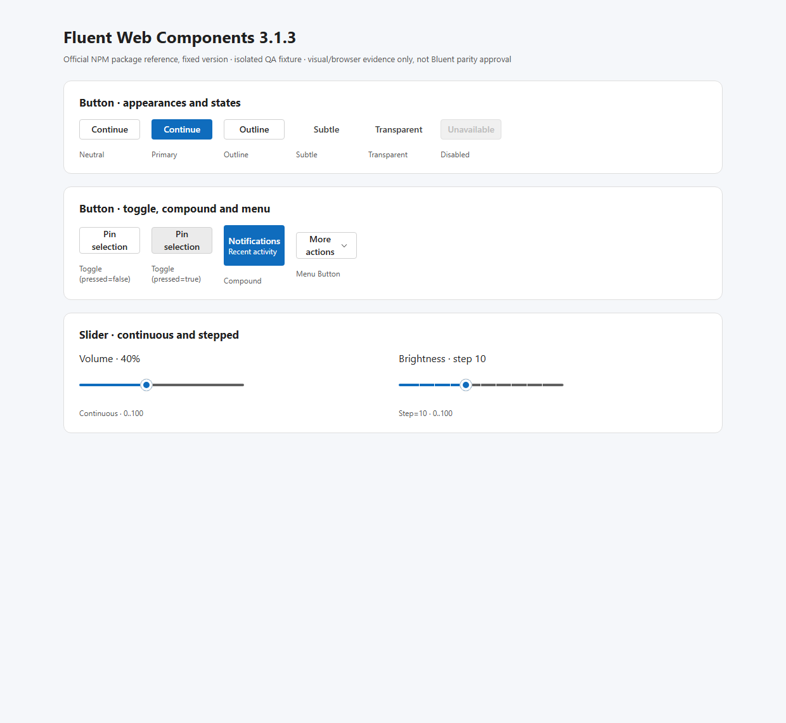
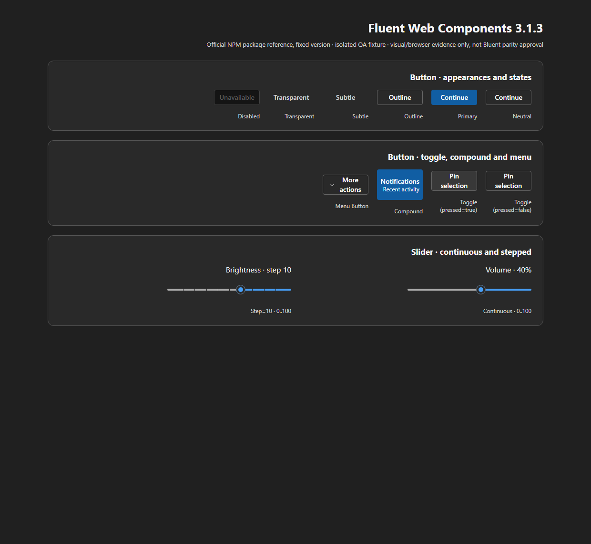
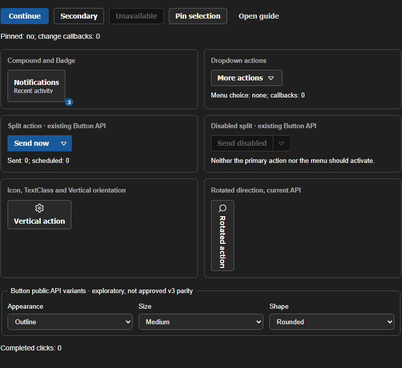
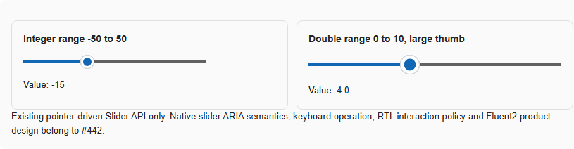
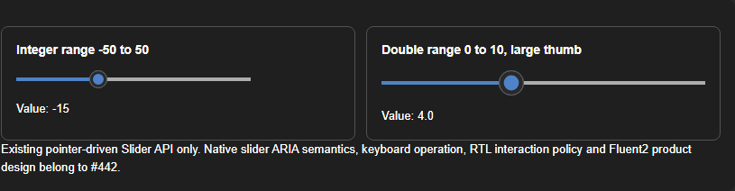
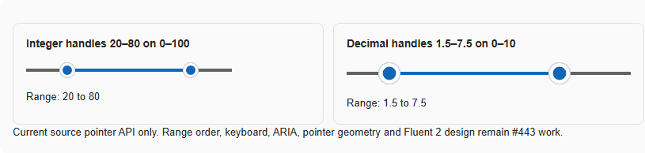
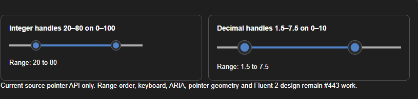
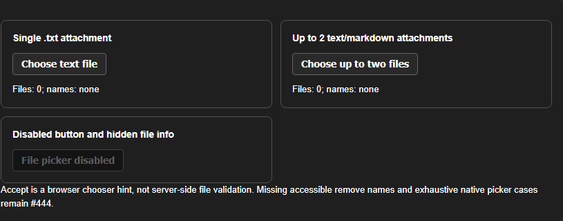

# #552 — same-nominal-width Chrome visual comparison, Light/LTR and Dark/RTL

**Executed 2026-10-19 on Dev01, real browser and real components. Evidence, not approved parity.**

This is the next step after the [first pinned WC 3.1.3 baseline](FLUENT-WC-3.1.3-VISUAL-BASELINE.md). Two *independent* disposable Chromium fixtures were run in **Light/LTR** and **Dark/RTL**. The official reference uses published `@fluentui/web-components@3.1.3` / `@fluentui/tokens@1.0.0-alpha.24`, actual `setTheme(webLightTheme/webDarkTheme)` and `dir=ltr/rtl`. The Bluent side uses actual source-built WebAssembly Component Lab #421 (source `b9952aa93e89fd569de54080a7fdd06037b53a41`), root `data-bui-theme=light/dark` and `dir=ltr/rtl`. The matching fixture **sets only nominal component widths and text**, not external layout structure or design tokens. It does not implement or simulate either component.

## Same-size primary Button

| Mode | Fluent (actual Chrome DOM) | Bluent (actual Chrome DOM) | Observation |
| --- | --- | --- | --- |
| Light/LTR | 96 × 32 px, background `rgb(15,108,189)` | 96 × 32 px, background `rgb(18,103,180)` | Same host geometry, **different actual fill colors** |
| Dark/RTL | 96 × 32 px, background `rgb(17,94,163)` | 96 × 32 px, background `rgb(22,93,162)` | Same host geometry, **different actual fill colors** |

Both reference and target render the actual **Continue** primary button, 96px wide. Color differences are measured but **not automatically bugs**: Fluent WC tokens and existing Bluent public theme tokens aren't the same token source, and exact brand mapping is still an unapproved design decision.

| Official Fluent Light/LTR | Current Bluent Light/LTR |
| --- | --- |
|  |  |

| Official Fluent Dark/RTL | Current Bluent Dark/RTL |
| --- | --- |
|  |  |

**No pixel diff** was run on these two independently composed pages. The screenshots can be reviewed visually for contextual direction/spacing, but they aren't equivalent whole-page layouts or font baselines.

## Narrow primary-Button crop pixel diagnostics (2026-10-24)

Separate from the independent full-page screenshots above, the primary Button host was captured from each **real rendered browser fixture** as an exact 96×32 CSS-pixel crop. Both show the visible label `Continue`; the Fluent side is the pinned published `@fluentui/web-components@3.1.3` fixture and the Bluent side is the real source-built Component Lab at `b9952aa93e89fd569de54080a7fdd06037b53a41`. Bluent's pointer was moved away and focus blurred before its rest-state crop. No Bluent product source or CSS was modified to produce these crops.

| Mode | Fluent rendered crop | Bluent rendered crop | Amplified RGB difference image | Diagnostic measurements |
| --- | --- | --- | --- | --- |
| Light/LTR |  |  |  | 3066/3072 pixels changed (99.80%); mean absolute RGB-channel delta 18.82 |
| Dark/RTL |  |  |  | 3066/3072 pixels changed (99.80%); mean absolute RGB-channel delta 20.79 |

Machine-readable metrics and input/diff SHA-256 hashes are in the [crop diagnostic JSON](evidence/FLUENT-BLUENT-BUTTON-PRIMARY-CROP-DIFF.json). Recompute and verify with `python scripts/quality/compare_v3_fluent_button_crops.py --write` and check with `--check`.

The raw changed-pixel ratio is **99.80% in both modes largely because the surface-fill RGB differs across almost the entire button face**; it must not be read as 99.8% of the component being visually wrong. The center-surface color deltas are Fluent vs Bluent **(3, 5, 9)** per RGB channel in Light/LTR and **(7, 5, 8)** in Dark/RTL. To separate fill color from high-contrast glyph pixels, the diagnostic also builds a foreground mask relative to each crop's own center RGB, using an exploratory max-channel threshold of 50 inside the inset region x=6–89, y=6–25:

| Mode | Fluent mask | Bluent mask | Foreground-mask bounds (Fluent / Bluent) | Mask IoU |
| --- | ---: | ---: | --- | ---: |
| Light/LTR | 314 px | 383 px | 57×10 px / 63×11 px | 0.443 |
| Dark/RTL | 333 px | 407 px | 58×10 px / 64×11 px | 0.495 |

These thresholded glyph/content masks indicate the Bluent label silhouette is about 6 px wider and begins one row higher in these captures. That is a **diagnostic lead** for typography/vertical alignment review, not yet a confirmed design defect: the cutoff is exploratory and font metrics, antialiasing, token differences and the approved Penpot frame have not been normalized.

**Interpretation limit:** a pixel is counted changed if any RGB channel differs by at least 1; this sensitive ratio is not a perceptual quality score or a pass/fail threshold. The amplified diff is for locating differences, not a similarity score. The crop has the same outer host size and label, but does not normalize the two token systems, font metrics/antialiasing, internal markup or approved Penpot geometry. The crop excludes outside focus/box-shadow pixels and app scaffolding. This is diagnostic evidence for one Button appearance in two modes only—not a parity verdict, visual approval, native OS high-contrast result or screen-reader acceptance. All 18 family dimensions remain `audited_gaps` and design approval remains pending.

## Same-width Slider

| Mode | Fluent WC Slider host | Bluent Slider host | Reproducible difference |
| --- | --- | --- | --- |
| Light/LTR | 260 × 32 px | 260 × 20 px | **12px outer-host height difference** |
| Dark/RTL | 260 × 32 px | 260 × 20 px | **12px outer-host height difference** |

The 12px difference is *not* an automatic visual bug: Fluent WC host box and Bluent `.bui-slider` host may reserve different internal thumb/focus space; component anatomy alignment must be assessed by an approved design frame. The official stepped WC Slider is verified with real `ArrowRight` keyboard action; current Bluent source has no native focusable Slider thumb or `Step`/active `Orientation` API. Published InteractiveServer pointer failure and coordinate-space issue remain open.

| Official Fluent WC Light/LTR | Bluent Slider Light/LTR |
| --- | --- |
|  |  |

| Official Fluent WC Dark/RTL | Bluent Slider Dark/RTL |
| --- | --- |
|  |  |

Official focused-slider evidence: [Light/LTR focus](evidence/FLUENT-WC-3.1.3-LIGHT-LTR-NORMALIZED-CHROME-KEYBOARD-FOCUS.png) · [Dark/RTL focus](evidence/FLUENT-WC-3.1.3-DARK-RTL-CHROME-KEYBOARD-FOCUS.png).

## Extensions, not invented counterparts

The pinned 3.1.3 release does not export a `fluent-range-slider` or `fluent-file-select` custom element tag. The actual Bluent specimens were captured under both Light/LTR and Dark/RTL:

| Current Bluent extension | Light/LTR | Dark/RTL |
| --- | --- | --- |
| RangeSlider #443 |  |  |
| FileSelect #444 |  |  |

## Repro and guard

- Scripts: `scripts/quality/probe_v3_fluent_wc_reference.mjs` and `scripts/quality/probe_v3_bluent_lab_reference.mjs` with an optional fourth `dark-rtl` or `light-ltr` argument; capture official NPM bundle in an **external scratch directory**, not committed code. Current WC entry point picks actual light/dark tokens.
- Four machine measurements: [Fluent Light/LTR](evidence/FLUENT-WC-3.1.3-LIGHT-LTR-NORMALIZED-CHROME.json), [Bluent Light/LTR](evidence/BLUENT-LAB-P0-LIGHT-LTR-CHROME.json), [Fluent Dark/RTL](evidence/FLUENT-WC-3.1.3-DARK-RTL-CHROME.json), [Bluent Dark/RTL](evidence/BLUENT-LAB-P0-DARK-RTL-CHROME.json).
- Both official Chrome runs **7/7 scenario assertions PASS**; both Bluent Chrome runs **7/7 observations/checks PASS**: tag registrations/theme/directives, actual render, WC pressed and Slider keyboard action plus official root page bounds, Blazor hydrated four P0 DOM elements and an **actual browser focus probe confirming the current Slider DOM has no native focus target** (a documented gap, not acceptance).
- Independent source snapshot guards and negative controls: `python -m unittest discover -s scripts/quality -p test_v3_p0_normalized_visual.py -v`.
- **RTL screenshot correction:** the first browser capture using `Page.captureScreenshot(captureBeyondViewport=true)` produced a *visually cropped* RTL reference even though its real DOM `main` was within the 1240px viewport (100–1140px). Re-captured the real WC reference with **viewport-only** `captureBeyondViewport=false`, and inspected the restored full Dark/RTL image. The renewed probe guards main/scroll widths (1240/1240px, no overflow); the screenshot is now genuinely visible and complete. This was a QA capture issue, not a product bug.

**Not performed:** accurate pixel-diff after matching layout/font/placement/theme tokens, screenshot acceptance by component designer, keyboard focus screenshot/AT on the Bluent side, Dark/LTR, Light/RTL and arbitrary mobile/zoom/high-contrast, OS screen readers. The recorded WC screenshots use real theme; Bluent dark is actual `data-bui-theme`. No one has authorized new product implementation under the audit.

No source/installer/product code changed. #552 remains **In progress**, #553 **Draft**, P0 owning tasks #428/#442/#443/#444 require separate design-first correction and verification.
## Native keyboard focus check on the Bluent Slider DOM

In each Bluent Light/LTR and Dark/RTL run, the browser directly executed `element.focus()` on the actual `#lab-slider-int` component DOM, **without adding `tabindex` or mutating the component**. The result was `rootFocused=false`, `rootTabIndex=-1`, `thumbTabIndex=-1`, and no `role=slider` or thumb `aria-valuenow`. This is a **reproduced Chrome keyboard-focus absence**, not only a C# source inference, and warrants #442 remediation. The official 3.1.3 focused stepped-slider `ArrowRight` case already passed separately; neither run supplies native screen-reader OS/AT results.
## Follow-up: Forced Colors and narrower reflow

The [subsequent actual browser checkpoint](FLUENT-WC-3.1.3-FORCED-COLORS-REFLOW.md) reproduces an important **gradient-only rail disappears under CSS Forced Colors** issue for Slider #442 and RangeSlider #443, plus separate Button/Slider focus results. The 620 CSS-pixel / DPR2 mode is **not native browser zoom**, and real Slider responsive width is preserved. Full OS/AT and 200/400% native browser zoom remain future gates.
