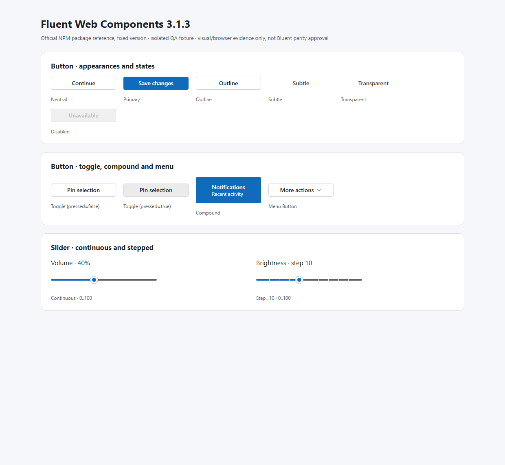
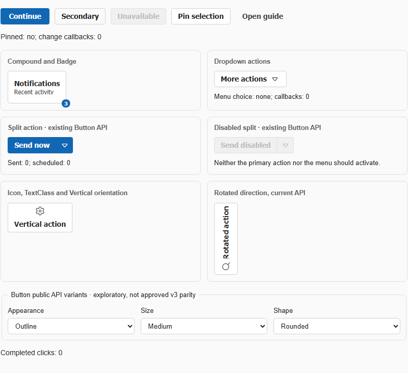
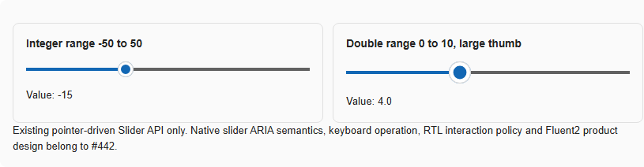
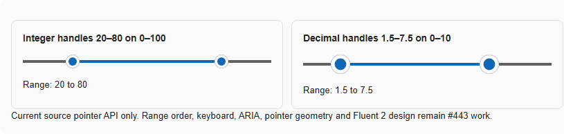
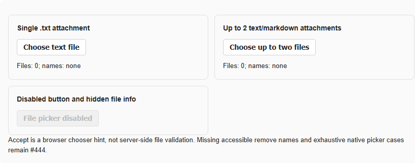

# #552 — actual pinned Fluent vs current Bluent Lab screenshots (2026-10-19)

> **First paired visual evidence; NOT pixel-by-pixel parity, Fluent approval or native OS/AT certification.** This is a real Chrome 1240×1140 deviceScaleFactor 1 capture from two separately hosted applications. No screenshot, illustration or UI was hand-drawn to imitate either product. The [official released reference](FLUENT-WC-3.1.3-P0-CROSSWALK.md) is exactly `@fluentui/web-components@3.1.3` with `@fluentui/tokens@1.0.0-alpha.24` / `webLightTheme`; the Bluent target is real `#421` Component Lab WebAssembly at source commit `b9952aa93e89fd569de54080a7fdd06037b53a41`. Both were launched with disposable localhost HTTP and fresh dedicated Chrome profiles.

## Button visual pair

| Official Fluent Web Components 3.1.3 | Current Bluent Button Component Lab |
| --- | --- |
|  |  |

The screenshots depict **different test layouts, contents, visual densities and nominal control widths**. Both sampled buttons are 32px high for the measured default/primary specimens, but the official demo's 160px button host width is constrained by its `preview` container; Bluent's sampled Button was 96px wide. **Do not** claim equal padding, typography, shape or layout tokens from these two independently constrained widths. Bluent Lab additionally exposes Split, Badge and rotated/vertical variants not placed in the official WC fixture; treat extra variants as a capability-mapping question rather than an automatic mismatch.

**Behavioral finding:** the official pinned `fluent-toggle-button` actually toggled its `pressed` state in Chrome; current Bluent `ToggledChanged` works in existing Lab checks, but its component-generated HTML does **not** automatically emit `aria-pressed`. Only source/audit-level missing semantics are asserted, not a native screen-reader outcome. Official reference has dedicated compound and menu button tags; Bluent uses different composition and parameters.

## Slider visual pair

| Official Fluent single-thumb reference | Current Bluent Slider |
| --- | --- |
|  |  |

The Fluent fixture measured a 260×32px `fluent-slider` host; Bluent's sampled Slider host measured approximately 351.5×20px inside its separate Card. **Those outer host dimensions are container-/fixture-dependent** and do not constitute a normalized geometry diff. Both show a filled progress segment, dark remaining track and circular thumb, but the actual thumb radius/stroke, component spacing, dark theme, RTL, zoom and forced-colors haven't been compared under normalized constraints.

**Verified official behavior:** real Chrome `ArrowRight` advanced a published WC `step="10"` Slider after keyboard focus. The official manifest declares `step`, `orientation`, `mode`, `value`, `min`, `max`, `size` and disabled properties. Existing Bluent Slider only declares Min, Max, Value, ValueChanged and ThumbSize (comments contain proposed Orientation/Size, not active API); source-only current thumb lacks native keyboard/slider ARIA metadata. Real Bluent WASM pointer ValueChanged was independently verified in #421's prior and current Lab; the known published InteractiveServer pointer gap remains **open**.

Official WC keyboard focus reference: [Fluent WC 3.1.3 stepped-slider focus screenshot](evidence/FLUENT-WC-3.1.3-LIGHT-CHROME-KEYBOARD-FOCUS.png).

## Non-identical components: RangeSlider and FileSelect

| Bluent-only current source specimens | Evidence |
| --- | --- |
| RangeSlider, two-thumb range |  |
| FileSelect, native upload + Cards |  |

No custom elements with the names `fluent-range-slider` and `fluent-file-select` are declared by the **specific pinned WC 3.1.3 release**. These images therefore do **not** invent an exact upstream WC visual comparison. W3C multi-thumb keyboard/ARIA, native browser file picker behavior, accessible remove Button, MaxFiles enforcement and secure upload validation remain independently owned by #443/#444, with a documented extension decision pending.

## Machine and run evidence

- [Official Chrome measurement / 5 passing assertions](evidence/FLUENT-WC-3.1.3-LIGHT-CHROME.json): actual official tag definitions, nonzero rendered elements, shadow rendering, ToggleButton pressed state and stepped Slider ArrowRight.
- [Bluent Chrome measurement / 5 passing assertions](evidence/BLUENT-LAB-P0-CHROME.json): 4 live component families, source branch/commit, native DOM sizes, thumb counts and missing explicit ARIA attributes.
- Reproduction scripts: `scripts/quality/probe_v3_fluent_wc_reference.mjs`, `scripts/quality/probe_v3_bluent_lab_reference.mjs`, and official fixture `scripts/quality/fixtures/fluent-wc-3.1.3-*.js/html`. The official NPM JS bundle is **not vendored into Bluent**; rebuild the fixture in an isolated scratch directory using the pinned packages documented in the [WC source crosswalk](FLUENT-WC-3.1.3-P0-CROSSWALK.md).
- Earlier separately repeated four-mode Component Lab smoke: [Chrome + Edge × WebAssembly + published InteractiveServer 904/904](FLUENT-PARITY-P0-LIVE-RERUN.md). **Those existing checks are not 904 Fluent parity tests, and published Server Slider/RangeSlider pointer ValueChanged was intentionally not among their assertions.**
- Actual screenshot files are saved under `docs/v3/quality/evidence/` and checked by `test_v3_p0_visual_evidence.py`. No native OS assistive technology was used, no actual user design approval was obtained, and dark/RTL/forced-colors plus comparable anatomy/state screenshots remain to do.

**Next release gate:** produce *normalized* same-state/same-size WC-vs-Bluent comparisons and source-owned editable component design approvals; validate all public API and actual keyboard/touch/SSR/OS-AT interactions; apply approved fixes through component owners #428/#442/#443/#444 only. Keep #552 In progress and PR #553 Draft.