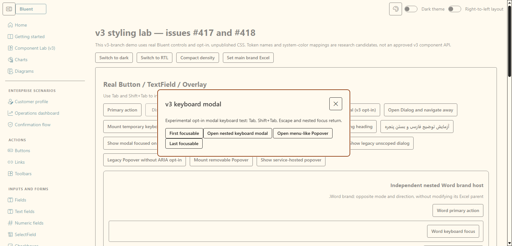
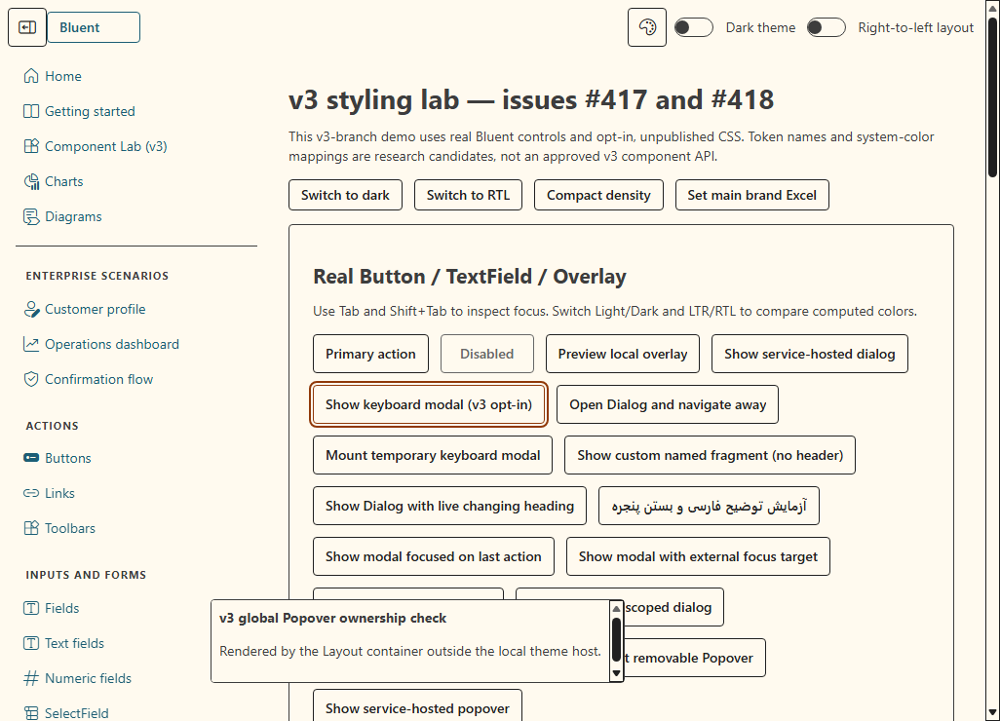

# Issue #418 — Native Windows High Contrast and UI Automation evidence

**Captured:** 2026-11-24
**Classification:** Limited native Windows engineering evidence for the opt-in Dialog/Popover prototype. This is not design, public API, screen-reader speech, or product accessibility acceptance.

## Environment and native OS mode

- OS: Windows 11 Pro, 10.0.28000, build 28000, x64.
- Browser: Microsoft Edge 158.0.4370.33.
- Fixture: published Release InteractiveServer host at /v3/interactive-portal-lab.
- Native scheme: **High Contrast White**.
- matchMedia(forced-colors: active): true.
- matchMedia(prefers-contrast: more): true.

The native SystemParametersInfoW High Contrast API reported the original state as flags **126** (High Contrast disabled, White scheme selected). The probe enabled the native flag temporarily with flags **127**, retained the exact scheme, and restored flags **126** after the run. A fresh native read verified the restored flags, enabled state, and scheme exactly match the original state.

## Dialog observations

The real Bluent service-hosted keyboard modal was opened on the published fixture.

DOM semantics while open:

| Property | Observation |
| --- | --- |
| Root role | dialog |
| aria-modal | true |
| aria-labelledby | f1de028b5_title |
| aria-describedby | absent on this prototype variant |
| Initial focus | Dialog root |
| Computed background | rgb(255, 250, 239) |
| Computed text / border | rgb(61, 61, 61) |
| Computed outline | rgb(144, 57, 9) |
| Box shadow | none |
| forced-color-adjust | auto |

Windows UI Automation ControlView inspection exposed the live Dialog as a named Window (v3 keyboard modal), its heading as a Text element, and the close action as an invokable Button named Close modal. The nested modal action was also exposed as a named Button.

Synthetic Windows-level key events were sent to the isolated Edge window:

- Tab: UIA reported focus on Close modal.
- Shift+Tab: UIA reported focus on Last focusable.
- Escape: the Dialog closed and browser focus returned to v3-show-keyboard-modal.

This is a limited path observation, not exhaustive focus wrapping or physical-keyboard acceptance.

## Popover observations

The real service-hosted Popover was opened, with these observations:

| Property | Observation |
| --- | --- |
| Trigger aria-expanded | true |
| Trigger aria-controls | v3-popover-trigger_surface |
| Trigger aria-haspopup | absent |
| Surface element | DIV |
| Surface explicit role | absent |
| Inner accessible label | v3 detached theme ownership probe |
| Surface computed background | rgb(255, 250, 239) |
| Surface computed text / border | rgb(61, 61, 61) |
| Box shadow | none |
| forced-color-adjust | auto |

UI Automation exposed the detached surface content as a named Group (v3 detached theme ownership probe) and its text as a Text element (v3 global Popover ownership check). The trigger was a named Button (Show service-hosted popover). The observed surface node had an opaque computed background in this run; no contrast ratio or ancestor/portal compositing claim is made.

## Method, cleanup, and limits

- UIA data came from the Windows AutomationElement ControlView tree for the isolated native Edge window.
- Keyboard actions used user32.keybd_event; they were synthetic OS input events, **not physical hardware key presses**.
- Narrator was not started. No Narrator, NVDA, or VoiceOver spoken output was captured or independently evaluated.
- Only High Contrast White was exercised. High Contrast Black and user-defined schemes remain untested.
- Screenshots are raw captures. They have not been independently pixel-reviewed or approved.
- Native High Contrast state was restored exactly, the probe-owned Edge processes were cleaned, and the isolated published host was stopped.

These observations identify concrete prototype semantics and a repeatable native Windows test path. They do not approve the semantic token allow-list, CSS alias names, Focus host contract, Dialog/Popover public API, canonical Penpot boards, or general product accessibility support. Issue #418 remains In progress.
