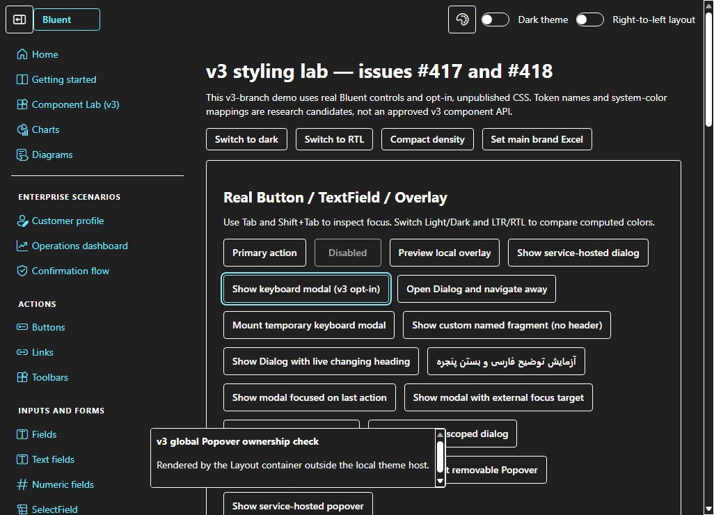
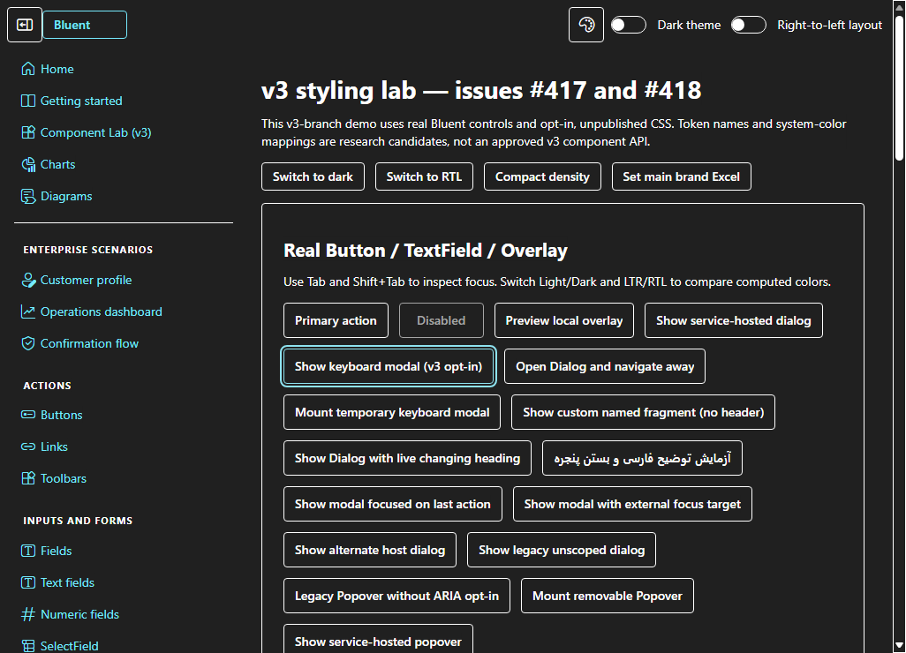

# Issue #418 — Native High Contrast Black: paired portal ThemeScope comparison

**Captured:** 2026-11-25  
**Classification:** Same-run, native Windows High Contrast Black engineering evidence for Bluent's detached Popover portals. Not public API/design approval, contrast certification, physical-keyboard acceptance, or spoken assistive-technology acceptance.

## Environment

- Windows 11 Pro build 28000, x64.
- Microsoft Edge 158.0.4370.33.
- Published Release InteractiveServer fixture: `/v3/interactive-portal-lab`.
- Native scheme: **High Contrast Black**; Edge reported `forced-colors: active` and `prefers-contrast: more`.
- The run began with HC Black already active (flags 127). The probe restored and verified exactly the same original flags, enabled state and scheme. It did not demonstrate a White-to-Black transition.

## Paired portal observations

Both service-hosted Popovers were opened and inspected **at the same time in the same browser session and native scheme**. One is under the lab's `CurrentScope`; the other is under a different `AlternateScope` (dark / Word / RTL). This removes uncertainty from comparing captures made at different times or with different browser states.

| Surface property | CurrentScope Popover | AlternateScope Popover |
| --- | --- | --- |
| Trigger | `v3-popover-trigger` | `v3-independent-popover-trigger` |
| `aria-expanded` | `true` | `true` |
| `aria-controls` | `v3-popover-trigger_surface` | `v3-independent-popover-trigger_surface` |
| Theme attribute | `light` | `dark` |
| Brand attribute | absent (default brand) | `word` |
| `data-bui-v3-tokens` | present | present |
| Density | `comfortable` | `comfortable` |
| Direction | `ltr` | `rtl` |
| Explicit surface role | absent | absent |
| Computed background | `rgb(32, 32, 32)` | `rgb(32, 32, 32)` |
| Computed text | `rgb(255, 255, 255)` | `rgb(255, 255, 255)` |
| Computed border / outline | `rgb(255, 255, 255)` | `rgb(255, 255, 255)` |
| `forced-color-adjust` | `auto` | `auto` |
| Box shadow | `none` | `none` |

## Interpretation

**ThemeScope propagation through the detached portal is working in this fixture.** The two detached surface roots carry different theme, brand and direction attributes (`light/default/ltr` versus `dark/word/rtl`), and both retain the v3 token marker. Therefore the earlier hypothesis that the white/dark sample necessarily meant a lost CascadingValue/ThemeScope was not supported.

Under native HC Black, both surfaces computed the same system black background and white foreground. This is consistent with forced-colors overriding their differing authored theme colors. It does not show the underlying light and dark token colors are equal; those values are intentionally superseded while the system contrast scheme is active. The role is absent on both surfaces because this probe exercises generic Popovers: a generic surface must not acquire a universal `dialog` role. DateField #438 will choose its own non-modal `dialog` semantics through the accepted consumer contract.

A prior, separate single-Popover HC Black capture recorded white background/dark text. The controlled paired capture here is stronger for diagnosing scope ownership because both surfaces were open in one session and both explicit scope signatures were read from the actual detached roots. The earlier raw artifact is retained as a separate observation, but should not be used to claim that portal ThemeScope was lost.

No numeric contrast pass is claimed. This artifact records computed values and native scheme state; it does not certify all hosts, alpha/gradient surfaces, native browsers, spoken screen readers, or user-defined Windows schemes.

## Integrity, restoration and limitations

- Dialog, CurrentScope Popover and AlternateScope Popover screenshots have SHA-256 values in the JSON manifest; all file digests and byte counts were verified against the files.
- Native HC state was restored exactly (`flags=127`, enabled, `High Contrast Black`; `exactlyMatchesOriginal=true`).
- Probe-owned Edge processes remaining after cleanup: **0**.
- Tab/Shift+Tab were synthetic OS events, not physical hardware input. No Narrator, NVDA or VoiceOver speech was captured.
- Only High Contrast Black was used in this comparison, on one Windows build and one Edge version.
- The probe refuses to overwrite existing evidence. Repeat runs require a unique `BLUENT_ISSUE418_NATIVE_EVIDENCE_SUFFIX`.

This is limited #418 engineering evidence only. Issue #418 remains In progress; dependent DateField #438 remains Backlog. No public API, production CSS, stable/v2 code, package or release changed.
