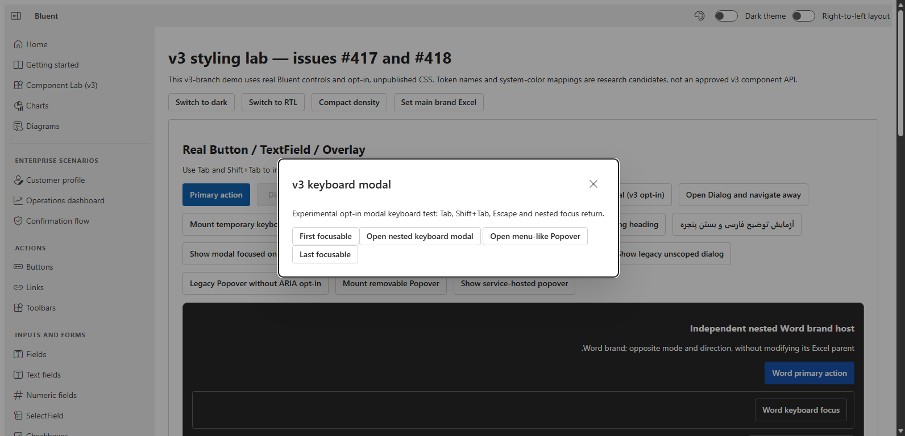
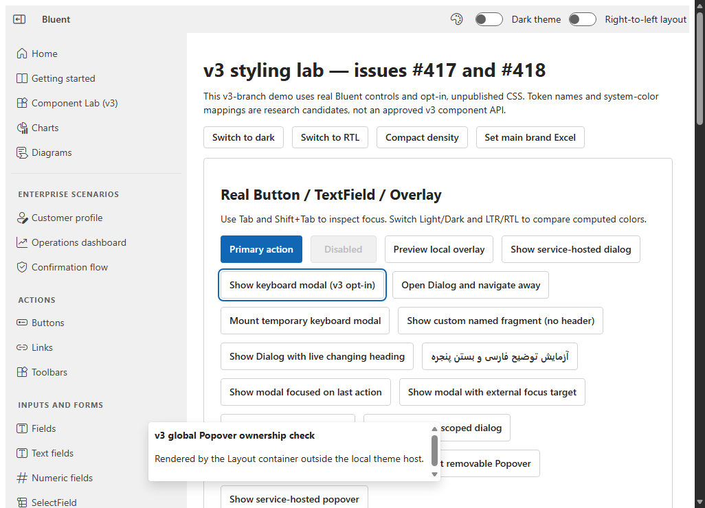

# Issue #418 — Native Windows High Contrast Black and UI Automation evidence

**Captured:** 2026-11-25  
**Classification:** Limited native Windows engineering evidence for the opt-in Dialog/Popover prototype. This is not design, public API, physical-keyboard, spoken assistive-technology, or product accessibility acceptance.

## Environment and native OS mode

- OS: Windows 11 Pro, build 28000, x64.
- Browser: Microsoft Edge 158.0.4370.33.
- Fixture: published Release InteractiveServer host at `/v3/interactive-portal-lab`.
- Native scheme requested and observed: **High Contrast Black**.
- `matchMedia(forced-colors: active)`: `true`.
- `matchMedia(prefers-contrast: more)`: `true`.

The probe records the exact native state it read before running: flags **127**, High Contrast enabled, scheme **High Contrast Black**. It applied the requested built-in Black scheme, verified the active state, and in `finally` restored and re-read the original flags and scheme. `exactlyMatchesOriginal` is `true`. Because Black was already active when this particular run began, this run did not demonstrate a White-to-Black transition; it verified Black-mode rendering and exact preservation/restoration of the already-active state.

## Dialog observations

A real Bluent service-hosted keyboard modal was opened on the published fixture.

| Property | Observation |
| --- | --- |
| Root role | `dialog` |
| `aria-modal` | `true` |
| `aria-labelledby` | `f4b8710ce_title` |
| Computed background | `rgb(32, 32, 32)` |
| Computed text | `rgb(255, 255, 255)` |
| Computed outline | `rgb(142, 227, 240)` |
| `forced-color-adjust` | `auto` |

Windows UI Automation ControlView inspection exposed the live Dialog as a named Window, its heading as Text, and the `Close modal` action as an invokable Button.

Synthetic Windows-level key events were sent to the isolated Edge window:

- Tab: UIA reported focus on `Close modal`.
- Shift+Tab: UIA reported focus on `Last focusable`.
- Escape: the Dialog closed and browser focus returned to `v3-show-keyboard-modal`.

This is a limited path observation, not exhaustive focus wrapping or physical-keyboard acceptance.

## Popover observations — open issue

The real service-hosted Popover was opened. Its trigger/surface relationship was observed:

| Property | Observation |
| --- | --- |
| Trigger `aria-expanded` | `true` |
| Trigger `aria-controls` | `v3-popover-trigger_surface` |
| Trigger `aria-haspopup` | absent (consumer-owned; this generic probe does not declare a popup type) |
| Controlled surface | `DIV` |
| Surface explicit role | absent |
| Surface computed background | `rgb(255, 255, 255)` |
| Surface computed text | `rgb(36, 36, 36)` |
| Surface computed outline | `rgb(36, 36, 36)` |
| Surface `forced-color-adjust` | `auto` |

UI Automation exposed the detached content as a named Group and its body as Text. The trigger was exposed as a named Button.

**Important finding:** while the native Dialog adopted the observed High Contrast Black system colors, the Popover surface still reported a white background and dark text in this run. No contrast pass is claimed. This is concrete evidence that the shared Popover portal/surface host needs a closer forced-colors review; consumer-selected role/name semantics and theme/forced-colors rendering remain separate concerns. The missing surface role is intentional for this generic consumer and does not mean every Popover should automatically become a Dialog.

## Method, cleanup, and limits

- Native mode was read and controlled through `SystemParametersInfoW` (`SPI_GETHIGHCONTRAST` / `SPI_SETHIGHCONTRAST`). The original flags and scheme were exactly restored and verified. The probe now refuses to overwrite an existing JSON or screenshot artifact; a deliberate repeat run must supply a unique `BLUENT_ISSUE418_NATIVE_EVIDENCE_SUFFIX` (uppercase letters/digits/hyphens, 1–32 chars).
- UIA data came from the Windows AutomationElement ControlView tree for the isolated native Edge window.
- Keyboard actions used `user32.keybd_event`; they were synthetic OS input events, **not physical hardware key presses**.
- Narrator was not started. No Narrator, NVDA, or VoiceOver spoken output was captured or independently evaluated.
- Only High Contrast Black was exercised in this run, on one Windows build and one Edge version. High Contrast White has a separate earlier evidence artifact; arbitrary user-defined schemes remain untested.
- Screenshots are raw captures with verified SHA-256 digests. They have not been independently pixel-reviewed or approved.
- Probe-owned Edge processes remaining after cleanup: **0**.

These observations add a reproducible native Black-mode evidence point and identify a concrete Popover forced-colors review item. They do not approve the semantic token allow-list, CSS aliases, Focus host contract, Dialog/Popover public API, canonical Penpot boards, spoken AT, or general product accessibility support. Issue #418 remains In progress; dependent DateField #438 remains Backlog.
