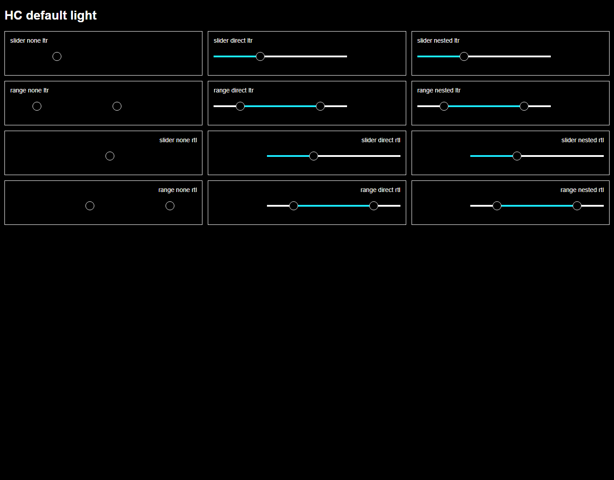
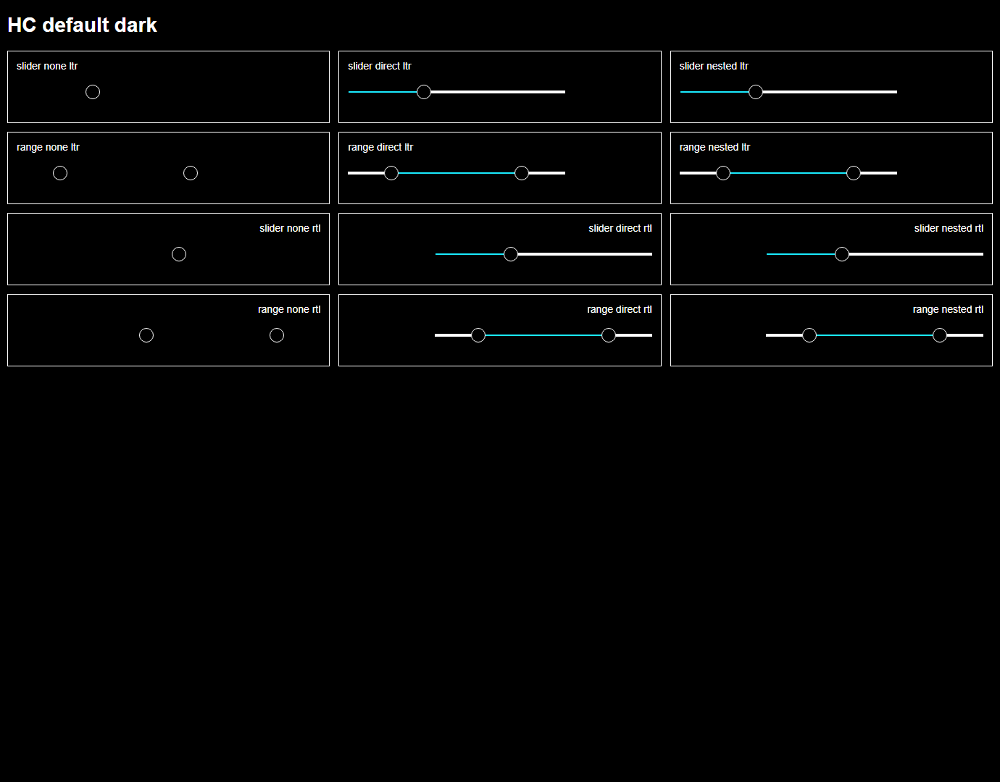

# #418 × #552 — Forced Colors track/progress opt-in token study for Slider and RangeSlider

**2026-10-20 · Real Chrome + Edge CSS evidence; not an accepted product fix.**

Owner boundaries: [#418 token/forced-colors policy](https://github.com/vrassouli/Bluent/issues/418), [#442 Slider](https://github.com/vrassouli/Bluent/issues/442), [#443 RangeSlider](https://github.com/vrassouli/Bluent/issues/443), [#552 historical parity audit](https://github.com/vrassouli/Bluent/issues/552). This branch is `v3/issue-418-design-tokens` and [PR #500](https://github.com/vrassouli/Bluent/pull/500) targets `bluent-v3` only.

## Verified current bug, narrow paint candidate

The real **tracked compiled** component CSS is from `src/Bluent.UI/Styles/Components/components.css` (byte-for-byte identical on Dev01 to the generated `src/Bluent.UI/wwwroot/bluent.ui.components.css`, SHA-256 `DEB8F4FBB667D3DB3E32C20777BC1A6AD68FBA0CF11BDCB7A91DEECAFF13F9E6`), source from `_slider.scss` and `_range-slider.scss`. Both use `linear-gradient(...)` **without a solid rail background**. With Chromium's `forced-colors: active`, the gradient disappears and the rail becomes transparent; both thumbs remain visible but the track is not. This was first verified on the actual hydrated #421 Blazor Lab in #552, not conjectured from markup.

A *separate, non-shipping* opt-in research stylesheet is now recorded: [`issue-418-slider-forced-colors.opt-in.preview.css`](issue-418-slider-forced-colors.opt-in.preview.css). Within `@media (forced-colors: active)`, only a host explicitly carrying **both** `data-bui-v3-tokens` and `data-bui-v3-slider-hc-proposal` (or a descendant under a v3 token host carrying the proposal flag) receives:

- **Rail:** no gradient, solid system-color `CanvasText`.
- **Selected segment:** `::after` painted in system-color `Highlight`, driven by the real source `--progress` or `--min-progress` / `--max-progress`.
- **No application-wide overrides:** opt-out hosts keep the existing behavior; the normal `forced-colors:none` mode keeps the original gradient, even under the opt-in host.

The source places its thumbs with physical `left: var(--progress)`, including inside `dir=rtl`. The candidate deliberately uses **physical `left`** for painted progress rather than `inset-inline-start`, which would place the painted segment opposite the current thumb geometry in RTL. **This does not approve the product's RTL value direction, keyboard order or multi-thumb interaction**; those are owned by #442 and #443 under the shared #420 contract.

## Two actual browser engines × all existing brands

This test uses **the actual tracked compiled Bluent component CSS** and the **20 real emitted brand-mode theme CSS files**, not a recreated approximation of the SCSS. The fixtures use representative static Slider/RangeSlider DOM nodes to inspect computed CSS; the earlier #552 test covers real Blazor host behavior separately.

| Dimension | Real Chrome | Real Edge |
| --- | ---: | ---: |
| Brands × modes | 10 × 2 | 10 × 2 |
| Directions | LTR + RTL | LTR + RTL |
| Families | Slider + RangeSlider | Slider + RangeSlider |
| Per-family scope | not opted in; direct opt-in; nested opt-in | same |
| Rendered computed-style specimens | **240** | **240** |
| Actual computed-style observations | **1,520 pass** | **1,520 pass** |
| Assertion errors | **0** | **0** |
| Browser leftovers | **0** | **0** |

There were **3,040 passing browser checks in total**. They assert that Forced Colors is really emulated; natural 300px×4px rail geometry persists; normal mode preserves the original gradient; opt-out track remains transparently missing (the known baseline); direct and nested opted-in tracks and selected segments are painted; and selected segment widths (105px Slider / 180px RangeSlider) and physical offsets align with the component's existing 35% and 20–80% thumb positions in **both LTR and RTL**.

| Actual Chrome Forced Colors QA screenshots | |
| --- | --- |
| Light source brand |  |
| Dark source brand |  |
| Edge Light source brand |  |
| Edge Dark source brand |  |

The Chrome Light PNG was **directly inspected**: absent rails without opt-in; visible white base / cyan selected segments with it, aligned to thumbs in both directions, and cards have visible spacing. The other PNGs and full measurements were captured by their respective browser runs; automated CSS checks also passed. The fixtures are not source Fluent component screenshots, a design board, or actual Windows Contrast Theme / screen-reader evidence.

## Reproduce, CI and ownership

From `C:/Projects/Bluent`, on a machine with Chrome and Edge:

```powershell
$env:CHROME_PATH = 'C:\Program Files\Google\Chrome\Application\chrome.exe'
node scripts/quality/probe_v3_slider_hc_token_candidate.mjs
$env:CHROME_PATH = 'C:\Program Files (x86)\Microsoft\Edge\Application\msedge.exe'
node scripts/quality/probe_v3_slider_hc_token_candidate.mjs
python -m unittest discover -s scripts/quality -p test_v3_slider_hc_token_candidate.py -v
```

Machine-readable evidence: [Chrome](evidence/SLIDER-HC-CHROME-MATRIX.json) and [Edge](evidence/SLIDER-HC-EDGE-MATRIX.json). **Eight additional pinned regression/negative-approval tests** run in #418 CI and assert evidence integrity, brand/mode scope, direct and nested opt-in isolation, normal-style preservation, percentage/RTL physical positioning, and no accidental product CSS edit. The browser test itself requires actual installed browsers and was performed separately on Dev01; CI's source job validates recorded observations and candidate boundaries, **not live Windows browser reruns**.

**Still blocking release:** approval of actual #418 system-color token names and editable Penpot design mapping; #442/#443 complete Fluent-aligned visual/behavior/API/keyboard/ARIA/RTL; native Windows HC/contrast themes and OS assistive technologies; touch/pointer handling and the known ScreenX/clientX defect; disabled/vertical/range bounds; real Blazor integration in both WASM and published Server. Neither this stylesheet nor the CSS sample is packaged or automatically loaded in product. Do not merge as an approved component fix or remove those issue gates. The canonical #418 high-contrast board remains [documented here](HIGH-CONTRAST-MOTION-DESIGN.md); Penpot connection was unavailable in this session, so **no new design edit or signoff was claimed**.
