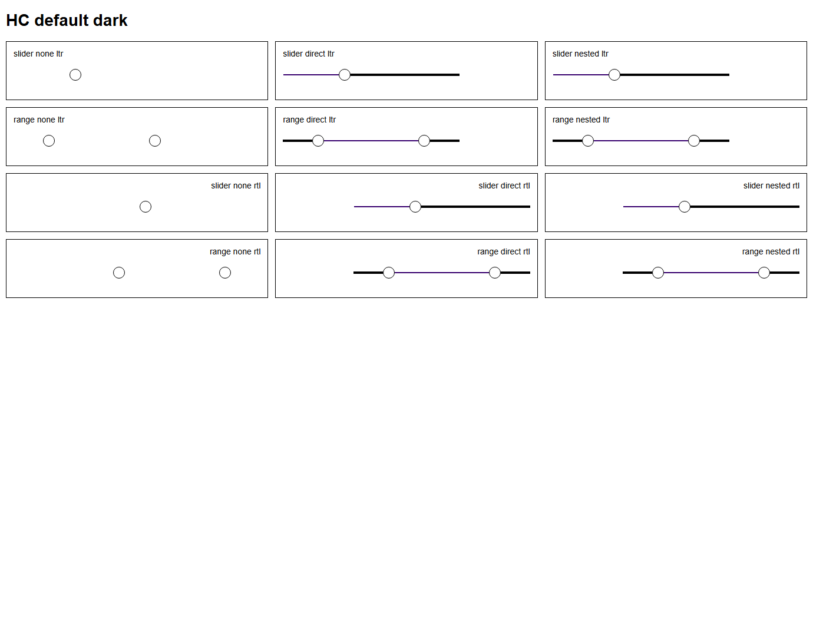

# #418 × #552 — Forced Colors track/progress opt-in token study for Slider and RangeSlider

**2026-10-20 · Real Chrome + Edge CSS evidence; not an accepted product fix.**

Owner boundaries: [#418 token/forced-colors policy](https://github.com/vrassouli/Bluent/issues/418), [#442 Slider](https://github.com/vrassouli/Bluent/issues/442), [#443 RangeSlider](https://github.com/vrassouli/Bluent/issues/443), [#552 historical parity audit](https://github.com/vrassouli/Bluent/issues/552). This branch is `v3/issue-418-design-tokens` and [PR #500](https://github.com/vrassouli/Bluent/pull/500) targets `bluent-v3` only.

## Verified current bug, narrow paint candidate

The real **tracked compiled** component CSS is from `src/Bluent.UI/Styles/Components/components.css` (byte-for-byte identical on Dev01 to the generated `src/Bluent.UI/wwwroot/bluent.ui.components.css`, SHA-256 `DEB8F4FBB667D3DB3E32C20777BC1A6AD68FBA0CF11BDCB7A91DEECAFF13F9E6`), source from `_slider.scss` and `_range-slider.scss`. Both use `linear-gradient(...)` **without a solid rail background**. With Chromium's `forced-colors: active`, the gradient disappears and the rail becomes transparent; both thumbs remain visible but the track is not. This was first verified on the actual hydrated #421 Blazor Lab in #552, not conjectured from markup.

A *separate, non-shipping* opt-in research stylesheet is now recorded: [`issue-418-slider-forced-colors.opt-in.preview.css`](issue-418-slider-forced-colors.opt-in.preview.css). Within `@media (forced-colors: active)`, only a host explicitly carrying **both** `data-bui-v3-tokens` and `data-bui-v3-slider-hc-proposal` (or a descendant under a v3 token host carrying the proposal flag) receives:

- **Rail:** no gradient, solid system-color `CanvasText`.
- **Selected segment:** `::after` painted in system-color `Highlight`, driven by the real source `--progress` or `--min-progress` / `--max-progress`.
- **No application-wide overrides:** opt-out hosts keep the existing behavior; the normal `forced-colors:none` mode keeps the original gradient, even under the opt-in host.

The source places its thumbs with physical `left: var(--progress)`, including inside `dir=rtl`. The candidate deliberately uses **physical `left`** for painted progress rather than `inset-inline-start`, which would place the painted segment opposite the current thumb geometry in RTL. **This does not approve the product's RTL value direction, keyboard order or multi-thumb interaction**; those are owned by #442 and #443 under the shared #420 contract.

## Two browser engines, all brands, two emulated OS palettes

This test uses **the actual tracked compiled Bluent component CSS** and the **20 real emitted brand-mode theme CSS files**, not a recreated approximation of the SCSS. The fixtures use representative static Slider/RangeSlider DOM nodes to inspect computed CSS; the earlier #552 test covers real Blazor host behavior separately.

| Dimension | Real Chrome | Real Edge |
| --- | ---: | ---: |
| Brands × product theme modes | 10 × 2 | 10 × 2 |
| Emulated system color scheme | dark + light | dark + light |
| Directions | LTR + RTL | LTR + RTL |
| Families | Slider + RangeSlider | Slider + RangeSlider |
| Per-family scope | not opted in; direct opt-in; nested opt-in | same |
| Rendered computed-style specimens | **480** | **480** |
| Actual computed-style observations | **4,160 pass** | **4,160 pass** |
| Assertion errors | **0** | **0** |
| Browser leftovers | **0** | **0** |

There were **8,320 passing browser checks in total**. They assert that Forced Colors is really emulated; natural 300px×4px rail geometry persists; normal mode preserves the original gradient; opt-out track remains transparently missing (the known baseline); direct and nested opted-in tracks and selected segments are painted; and selected segment widths (105px Slider / 180px RangeSlider) and physical offsets align with the component's existing 35% and 20–80% thumb positions in **both LTR and RTL**.

| Actual Chrome Forced Colors QA screenshots | |
| --- | --- |
| Light source brand |  |
| Dark source brand |  |
| Light brand, light system palette |  |
| Dark brand, light system palette |  |
| Edge Light source brand |  |
| Edge Dark source brand |  |
| Edge Light brand, light system palette |  |
| Edge Dark brand, light system palette |  |

Both Chrome Light-source-brand PNGs for the dark and light emulated OS schemes were **directly inspected**: absent rails without opt-in; the dark OS palette shows a white rail and cyan selection, while the light OS palette shows a black rail and purple selection. Both align to thumbs in LTR/RTL and all cards have visible gaps. The other PNGs and full measurements were captured by their respective browser runs; automated CSS checks also passed. The fixtures are not source Fluent component screenshots, a design board, or actual Windows Contrast Theme / screen-reader evidence.

## Second audit: paint visibility is not contrast (2026-10-20)

A manual examination of the saved **real forced-colors computed styles** uncovered a flaw in the initial visually pleasing candidate: `CanvasText` on Chromium's active emulated dark contrast palette resolved to **white** (`rgb(255,255,255)`), while `Highlight` was **cyan** (`rgb(26,235,255)`). These two adjacent solid rail fills contrast only **1.461:1**, not a suitable 3:1 visual separation by themselves. Passing the original 3,040 position/visibility checks never established this criterion.

The current (still non-shipping) opt-in CSS therefore gives the selected-segment pseudo-element an **inset 1px solid Canvas boundary** with `box-sizing:border-box`, leaving the 4px base rail geometry and 35% / 20–80% selected widths unchanged. In the actual emulated palette `Canvas` resolves to black (`rgb(0,0,0)`): its boundary contrasts **21:1 with the white rail** and **above 10:1 with the cyan selection**. This makes the boundary legible without assuming white and cyan themselves contrast sufficiently. Native Windows Contrast Themes may have different palettes and still need direct testing.

Both real Chrome and Edge were **rerun** from the versioned source CSS for all 240 specimens per browser with **1,840/1,840 passing measured assertions each = 3,680/3,680 total**. Added numerical checks ensure 1px border, **at least 3:1 boundary contrast against both adjacent painted segments**, no overflow/RTL alignment drift, and opt-in isolation across all captured cases. The expanded Python evidence gate has **10/10 PASS** including its own negative control for the original **1.461:1** combination. Four screenshots and both JSON matrices were recaptured after the change.

**Research scope:** the improvement is a visual boundary candidate, not a proof of a WCAG-compliant interactive control. It does not fix missing thumb semantics, keyboard behavior, native Windows High Contrast/AT, zoom/actual touch, or design acceptance. The endorsed final token roles remain an explicit #418 / #442 / #443 designer decision.

## Third audit: two genuinely different emulated system palettes

The previous 3,680 passing checks exercised one emulated OS Forced Colors palette under twenty brand themes. Product brand theme and the user's system contrast palette are separate dimensions. The expanded probe requests both dark and light system-color schemes through the Chromium Forced Colors and prefers-color-scheme media emulation, sets matching color-scheme on the root, and verifies the selected palette using browser matchMedia.

| Actual computed system paint | Dark emulated palette | Light emulated palette |
| --- | --- | --- |
| CanvasText rail | white, rgb(255,255,255) | black, rgb(0,0,0) |
| Highlight selected segment | cyan, rgb(26,235,255) | deep purple, rgb(55,0,110) |
| Canvas boundary, 1px | black, rgb(0,0,0) | white, rgb(255,255,255) |

The additional palette exposed an incorrect **test-only assumption**: fully transparent pixels can be returned as rgba(255,255,255,0) instead of rgba(0,0,0,0). The audit originally treated the former as opaque, generating a false opt-out failure. The harness now identifies transparency by alpha, not RGB.

Actual Chrome and Edge were rerun successfully: **480 rendered specimens / 4,160 verified computed-style checks per browser; 8,320/8,320 total**. The selected 1px Canvas boundary retains at least **3:1 contrast against both adjacent painted areas in each emulated palette**. Eleven recorded Python regression/negative-approval tests pass, including verification that both palettes are distinctly resolved and applied across every real product brand/theme combination. Four more screenshots were captured, bringing the total to eight. The light OS-palette Chrome image was visually inspected. The non-opted controls remain as-is and the normal mode keeps its original gradient.

**Scope limit:** This covers two Chromium-emulated color schemes, NOT real Windows Contrast Themes, custom user palettes, native screen readers, focus/keyboard semantics, disabled/vertical behavior, or complete Fluent parity. The boundary is still a separate non-shipping design candidate, requiring approval in the correct Bluent Penpot file before any #442/#443 component implementation.

## Design-tool connection check

Penpot UI on the user-specified VHD-PC4 was checked: the existing Penpot plugin was attached to **PuyaStudio Runner**, not the authoritative **Bluent v3 Design System** (`b64f6665-c9ab-80b5-8008-c4ac99d9d000`). VHD-PC4's desktop reported **`WinDisc`**, so its window-focus, accessibility snapshot and screen capture operations could not safely activate the correct file, although terminal commands were available. The explicitly authorized Figma fallback was attempted against the already-owned #552 review file, but the API returned a Starter plan MCP rate limit. **No Penpot/Figma change and no visual design approval were made** in this step; the correct editable Penpot board remains a genuine review blocker.
## Reproduce, CI and ownership

From `C:/Projects/Bluent`, on a machine with Chrome and Edge:

```powershell
$env:CHROME_PATH = 'C:\Program Files\Google\Chrome\Application\chrome.exe'
node scripts/quality/probe_v3_slider_hc_token_candidate.mjs
$env:CHROME_PATH = 'C:\Program Files (x86)\Microsoft\Edge\Application\msedge.exe'
node scripts/quality/probe_v3_slider_hc_token_candidate.mjs
python -m unittest discover -s scripts/quality -p test_v3_slider_hc_token_candidate.py -v
```

Machine-readable evidence: [Chrome](evidence/SLIDER-HC-CHROME-MATRIX.json) and [Edge](evidence/SLIDER-HC-EDGE-MATRIX.json). **Eleven additional pinned regression/negative-approval tests** run in #418 CI and assert evidence integrity, brand/mode scope, direct and nested opt-in isolation, normal-style preservation, percentage/RTL physical positioning, and no accidental product CSS edit. The browser test itself requires actual installed browsers and was performed separately on Dev01; CI's source job validates recorded observations and candidate boundaries, **not live Windows browser reruns**.

**Still blocking release:** approval of actual #418 system-color token names and editable Penpot design mapping; #442/#443 complete Fluent-aligned visual/behavior/API/keyboard/ARIA/RTL; native Windows HC/contrast themes and OS assistive technologies; touch/pointer handling and the known ScreenX/clientX defect; disabled/vertical/range bounds; real Blazor integration in both WASM and published Server. Neither this stylesheet nor the CSS sample is packaged or automatically loaded in product. Do not merge as an approved component fix or remove those issue gates. The canonical #418 high-contrast board remains [documented here](HIGH-CONTRAST-MOTION-DESIGN.md); Penpot connection was unavailable in this session, so **no new design edit or signoff was claimed**.
